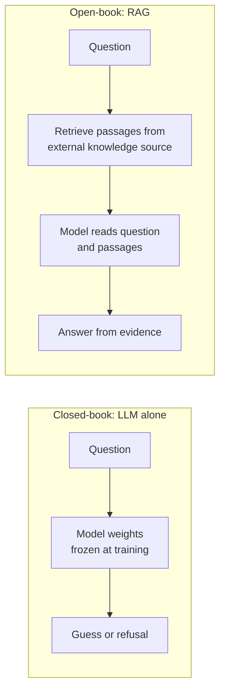
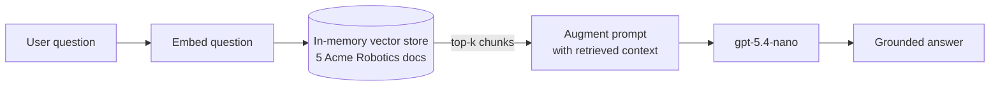
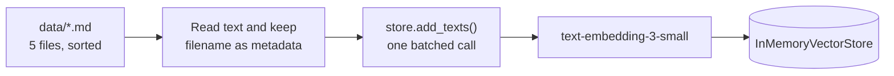
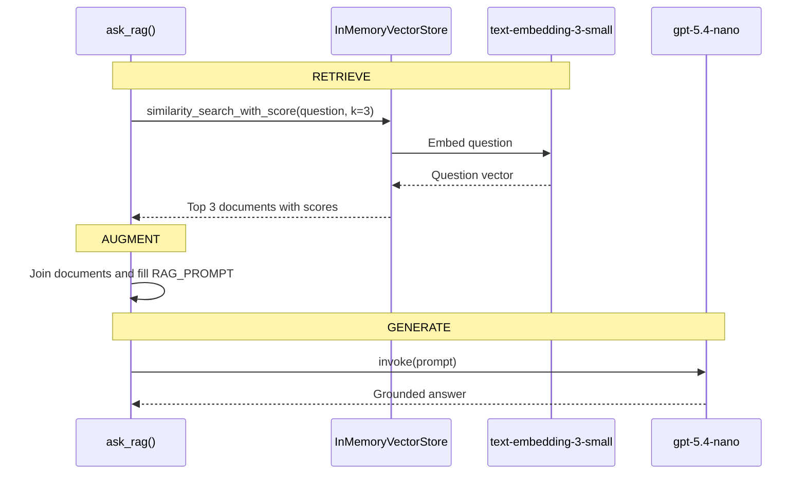
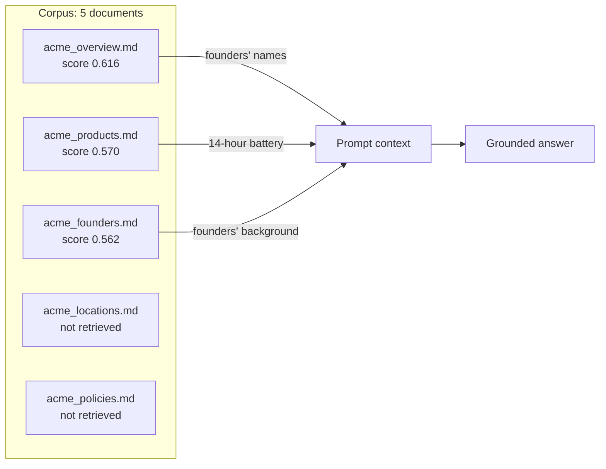
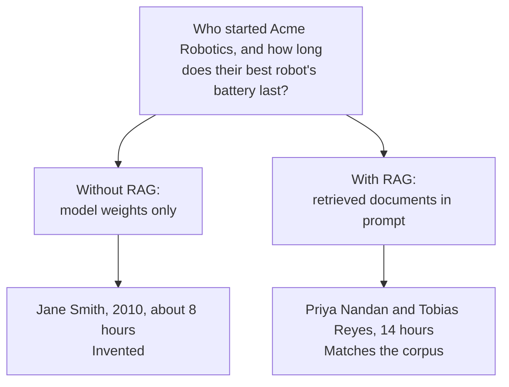

# 01 — RAG Explained: What It Is & Why LLMs Need It

Converted from [`rag_explained.ipynb`](https://github.com/yashjainio/rag-youtube/blob/main/01_rag_explained/rag_explained.ipynb).
Code and outputs are copied unchanged from the notebook. The Architecture diagram is the
notebook's own; the other diagrams and every paragraph marked **Note** were added for this
document.

**Contents**

- [01 — RAG Explained: What It Is \& Why LLMs Need It](#01--rag-explained-what-it-is--why-llms-need-it)
  - [What is RAG?](#what-is-rag)
  - [Architecture](#architecture)
  - [Setup](#setup)
  - [`naive_llm` — ask the LLM about Acme Robotics with NO context at all](#naive_llm--ask-the-llm-about-acme-robotics-with-no-context-at-all)
  - [`tiny_rag` — the smallest possible working RAG pipeline](#tiny_rag--the-smallest-possible-working-rag-pipeline)
    - [Indexing: `build_store()`](#indexing-build_store)
    - [Answering: `ask_rag()`](#answering-ask_rag)
    - [Result](#result)
  - [Run it end-to-end](#run-it-end-to-end)
  - [Key concepts](#key-concepts)
  - [Try this yourself](#try-this-yourself)
  - [Common pitfalls](#common-pitfalls)
  - [The Acme Robotics corpus](#the-acme-robotics-corpus)

## What is RAG?

An LLM's knowledge is frozen at training time — it's baked into the model's weights and
can't change afterward. That's like taking a **closed-book exam**: whatever you know, you
know, and nothing on the desk in front of you can fill a gap. It can't answer questions
about anything private, anything newer than its training cutoff, or anything simply never
in its training data. Ask anyway, and it either guesses (hallucination) or refuses.

**Retrieval-Augmented Generation (RAG)** turns that into an **open-book exam**. Instead of
relying only on what the model memorized, RAG hands it the right page from the book at the
moment it's asked a question. Concretely, that's two steps glued together:

1. **Retrieve** — search an external knowledge source (docs, a database, a wiki) for the
   handful of passages most relevant to the question.
2. **Augment & Generate** — paste those passages into the model's prompt as context, then
   let the model generate its answer _from that evidence_ instead of from memory alone.



That's it — no retraining, no fine-tuning. Update the knowledge source and the very next
query sees the change, which is what makes RAG the default way to connect an LLM to
information it was never trained on. The rest of this series is really just this one loop
— retrieve, augment, generate — explored one component at a time: how retrieval finds the
right passages, how chunking prepares text for it, how vector databases store it at scale,
and so on.

## Architecture



## Setup

Uses `OPENAI_API_KEY` from the shared `.env` at the repo root.

```python
from pathlib import Path
from dotenv import load_dotenv

# override=True so re-running this cell picks up edits to .env without restarting the kernel
load_dotenv(override=True)

DATA_DIR = Path("data")
```

**Note:** `DATA_DIR` is relative, so run the code from `01_rag_explained/`.

The code also needs three packages. This project manages them with uv:

```bash
uv add langchain-core langchain-openai python-dotenv
```

## `naive_llm` — ask the LLM about Acme Robotics with NO context at all

Acme Robotics is a fictional company invented for this repo, so the model has never seen it
during pretraining. This proves the point on camera: without retrieval, the model either
hallucinates a plausible-sounding but wrong answer, or admits it doesn't know. Compare this
output to the `tiny_rag` output below.

```python
from langchain_openai import ChatOpenAI

# Deliberately about a fictional company - the base LLM can't know this, which is the point of the demo
QUESTION = "Who started Acme Robotics, and how long does their best robot's battery last?"


def ask_naive(question: str) -> str:
    # temperature=0 for reproducible output when we compare naive vs RAG answers
    llm = ChatOpenAI(model="gpt-5.4-nano", temperature=0)
    response = llm.invoke(question)
    return response.content
```

```python
print("=" * 70)
print("NAIVE LLM (no retrieval, no context)")
print("=" * 70)
print(f"Q: {QUESTION}\n")
answer = ask_naive(QUESTION)
print(f"A: {answer}")
print("\n^ Notice this is either a refusal or a hallucination — the model")
print("  has never seen the fictional 'Acme Robotics' company before.")
```

Output:

```text
======================================================================
NAIVE LLM (no retrieval, no context)
======================================================================
Q: Who started Acme Robotics, and how long does their best robot's battery last?

A: Acme Robotics was founded by Jane Smith in 2015. Their best robot's battery lasts approximately 4 hours on a full charge.

^ Notice this is either a refusal or a hallucination — the model
  has never seen the fictional 'Acme Robotics' company before.
```

**Note:** Every fact in that answer is invented. The corpus says the founders are Priya
Nandan and Tobias Reyes, the founding year is 2031, and the Junebug battery lasts 14 hours.

## `tiny_rag` — the smallest possible working RAG pipeline

The loop is: RETRIEVE the most relevant chunks -> AUGMENT the prompt with them -> GENERATE
an answer grounded in that context. No vector DB server, no chunking library — just
LangChain's `InMemoryVectorStore` over 5 tiny markdown files, so the mechanics are visible
end to end.

```python
from langchain_core.vectorstores import InMemoryVectorStore
from langchain_openai import ChatOpenAI
from langchain_openai import OpenAIEmbeddings

# Instruct the model to stick to the retrieved context instead of falling back on its own knowledge
RAG_PROMPT = """Answer the question using ONLY the context below. \
If the context doesn't contain the answer, say you don't know.

Context:
{context}

Question: {question}

Answer:"""


def build_store() -> InMemoryVectorStore:
    """Embed every doc in data/ and load it into an in-memory vector store."""
    embeddings = OpenAIEmbeddings(model="text-embedding-3-small")
    store = InMemoryVectorStore(embeddings)

    docs, metadatas = [], []
    # sorted() for a deterministic file order -- otherwise glob() order can vary by OS/filesystem,
    # which would make "chunk 2" mean a different doc on different runs
    for path in sorted(DATA_DIR.glob("*.md")):
        docs.append(path.read_text())
        # keep the filename around so we can show provenance for each retrieved chunk
        metadatas.append({"source": path.name})

    # add_texts embeds all 5 docs in a single batched API call rather than one call per doc --
    # cheap here since the corpus is tiny, but this is the same batching instinct you want at scale
    store.add_texts(docs, metadatas=metadatas)
    print(f"Indexed {len(docs)} documents from {DATA_DIR}")
    return store


def ask_rag(store: InMemoryVectorStore, question: str, k: int = 3) -> str:
    # RETRIEVE - embed the question and pull the k most similar chunks
    results = store.similarity_search_with_score(question, k=k)
    print(f"\nRetrieved {len(results)} chunks:")
    for doc, score in results:
        print(f"  score={score:.3f}  source={doc.metadata['source']}")

    # AUGMENT - stitch retrieved chunks into the prompt, separated so the model can tell them apart
    context = "\n\n---\n\n".join(doc.page_content for doc, _ in results)
    prompt = RAG_PROMPT.format(context=context, question=question)

    # GENERATE - same naive LLM, but now grounded in the retrieved context
    llm = ChatOpenAI(model="gpt-5.4-nano", temperature=0)
    return llm.invoke(prompt).content
```

### Indexing: `build_store()`

Runs once, before any question is asked.



**Note:** Nothing splits the files, so each whole file is one "chunk" here. Chunking is
covered later in the series.

### Answering: `ask_rag()`

Runs for every question.



The prompt sent to the model has this shape:

```text
Answer the question using ONLY the context below. If the context doesn't contain the answer, say you don't know.

Context:
<document 1>

---

<document 2>

---

<document 3>

Question: <question>

Answer:
```

### Result

```python
print("=" * 70)
print("TINY RAG (retrieve -> augment -> generate)")
print("=" * 70)
store = build_store()
print(f"\nQ: {QUESTION}")
answer = ask_rag(store, QUESTION)
print(f"\nA: {answer}")
```

Output:

```text
======================================================================
TINY RAG (retrieve -> augment -> generate)
======================================================================
Indexed 5 documents from data

Q: Who started Acme Robotics, and how long does their best robot's battery last?

Retrieved 3 chunks:
  score=0.616  source=acme_overview.md
  score=0.570  source=acme_products.md
  score=0.562  source=acme_founders.md

A: Priya Nandan and Tobias Reyes started Acme Robotics. Their best robot, the Junebug, has a battery life of 14 hours.
```

**Note:** The answer needs two documents. `acme_overview.md` names the founders and
`acme_products.md` gives the battery life, so no single file could answer the question.



## Run it end-to-end

Run `naive_llm` and `tiny_rag` side by side on the same question, so the difference
retrieval makes is obvious in one screen.

```python
print("Question:", QUESTION)

print("\n" + "=" * 70)
print("WITHOUT RAG")
print("=" * 70)
print(ask_naive(QUESTION))

print("\n" + "=" * 70)
print("WITH RAG")
print("=" * 70)
# rebuilt here rather than reusing the `store` from cell 10 -- this cell is meant to be a
# standalone "run everything" demo, and re-embedding 5 tiny docs is cheap enough not to matter
store = build_store()
print(ask_rag(store, QUESTION))
```

Output:

```text
Question: Who started Acme Robotics, and how long does their best robot's battery last?

======================================================================
WITHOUT RAG
======================================================================
Acme Robotics was founded by Jane Smith in 2010. Their best robot's battery lasts approximately 8 hours on a full charge.

======================================================================
WITH RAG
======================================================================
Indexed 5 documents from data

Retrieved 3 chunks:
  score=0.616  source=acme_overview.md
  score=0.570  source=acme_products.md
  score=0.562  source=acme_founders.md
Priya Nandan and Tobias Reyes started Acme Robotics. Their best robot, the Junebug, has a battery life of 14 hours.
```



**Note:** The naive answer changed between the two saved runs (2015 and 4 hours, then 2010
and 8 hours), even with `temperature=0`. So `temperature=0` doesn't guarantee identical
output. The RAG answer stayed the same in both saved runs.

## Key concepts

1. **Knowledge cutoff & hallucination** — the model can't know about anything invented
   after training, like our fictional "Acme Robotics." It will guess or refuse.
2. **The retrieve → augment → generate loop** — the core mechanical pattern behind every
   RAG system, no matter how sophisticated it gets later in this series.
3. **Context window as the real constraint** — you can't just paste your whole knowledge
   base into every prompt; retrieval picks the few chunks that matter.
4. **RAG vs. fine-tuning vs. long-context** — RAG updates knowledge without retraining and
   without paying to process irrelevant tokens on every call; each approach has a place.

| Approach     | How knowledge gets updated | Tokens processed per call |
| ------------ | -------------------------- | ------------------------- |
| RAG          | Re-index the changed docs  | Question plus top-k chunks |
| Fine-tuning  | Train the model again      | Question only             |
| Long-context | Edit the text in the prompt | Question plus the whole text |

## Try this yourself

1. Edit `data/acme_policies.md` to change the return window from 45 to 60 days, rerun the
   notebook, and confirm the RAG answer updates immediately with zero retraining.
2. Ask a question whose answer isn't in any of the 5 docs (e.g. "What color is the
   Junebug?") and see the RAG pipeline correctly say it doesn't know instead of guessing.
3. Change `k` in `ask_rag()` from 3 to 1 and see whether the answer degrades — this is your
   first taste of why chunk count/size matters (full topic in Episode 03).

**Note:** For exercise 1, also change `QUESTION` to ask about returns, because the default
question doesn't touch the return window. The edit only takes effect after `build_store()`
runs again. For exercise 3, the saved scores suggest what to expect: `k=1` keeps only
`acme_overview.md`, which names the founders but has no battery figure.

## Common pitfalls

- **Forgetting `k` matters**: retrieving too few chunks starves the model of context;
  retrieving too many wastes tokens and can dilute relevant information.
- **Assuming retrieval always finds the right chunk**: it's a similarity search, not magic —
  garbage or off-topic source docs still produce garbage answers.
- **No source diversity check here**: this toy example doesn't dedupe or balance sources —
  that becomes important once your corpus grows past a handful of files.

## The Acme Robotics corpus

These are the 5 fictional documents the pipeline searches, copied unchanged from the
notebook's `data/` folder.

| Document                                   | Contents                                                   |
| ------------------------------------------ | ---------------------------------------------------------- |
| [acme_overview.md](../data/acme_overview.md)   | Founding, headcount, offices, mission            |
| [acme_founders.md](../data/acme_founders.md)   | Priya Nandan, Tobias Reyes, bootstrapped funding |
| [acme_products.md](../data/acme_products.md)   | Junebug, Cricket, HiveMind software              |
| [acme_locations.md](../data/acme_locations.md) | Boulder headquarters, Porto office               |
| [acme_policies.md](../data/acme_policies.md)   | Returns, support response times, warranty        |
