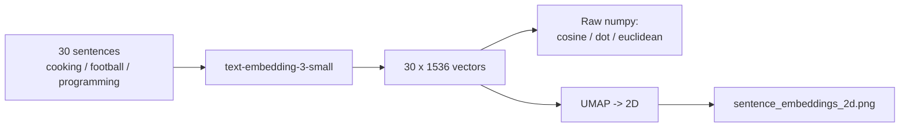
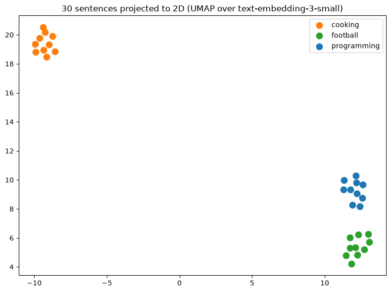

# 02 — Embeddings & Vector Similarity from Scratch

Converted from [`embeddings_similarity.ipynb`](https://github.com/yashjainio/rag-youtube/blob/main/02_embeddings_similarity/embeddings_similarity.ipynb).
Code and outputs are copied unchanged from the notebook. The Architecture diagram and the
scatter plot are the notebook's own; the tables and every paragraph marked **Note** were
added for this document.

**Contents**

- [Quick revision](#quick-revision)
- [What you'll learn](#what-youll-learn)
- [Architecture](#architecture)
- [Setup](#setup)
- [`load_sentences`: flatten the sentence set](#load_sentences--shared-helper-flatten-the-3-topic-sentence-set)
- [`raw_similarity`: coordinates for meaning](#raw_similarity--embeddings-are-just-coordinates-for-meaning)
- [`visualize`: look at the embeddings](#visualize--literally-look-at-the-embeddings)
- [Run it end-to-end](#run-it-end-to-end)
- [Key concepts](#key-concepts)
- [Try this yourself](#try-this-yourself)
- [Common pitfalls](#common-pitfalls)
- [The sentence set](#the-sentence-set)

## Quick revision

**In one line:** an embedding is a list of numbers whose position encodes meaning, and
similarity search is comparing those lists.

**What we learned**

- 30 sentences in 3 topics became 30 vectors of 1,536 numbers each with
  `text-embedding-3-small`.
- Every sentence's 3 nearest neighbours came from its own topic, with no topic label given
  to the model.
- Same-topic pairs average 0.299 cosine similarity; different-topic pairs average 0.087.
- UMAP squeezed the vectors into 2D, and the 3 topics show up as 3 clusters.

**Why it matters**

- This is the math behind retrieval in Episode 01. Every vector store (`InMemoryVectorStore`,
  Chroma, Qdrant) runs it behind `similarity_search`.
- Knowing what the scores mean stops you setting thresholds that silently drop good matches.

**How the code does it**

| Function | What it does |
| --- | --- |
| `load_sentences()` | Flattens `sentences.json` into parallel `sentences` and `topics` lists |
| `embed_sentences()` | Calls the embedding model and returns a NumPy array, one row per sentence |
| `cosine_similarity_matrix()` | Scales every row to length 1, then takes dot products |
| `dot_product_matrix()` | Plain dot products, sensitive to vector length |
| `euclidean_distance_matrix()` | Straight-line distance, computed with the `‖a‖² + ‖b‖² − 2a·b` expansion |
| `project_to_2d()` | UMAP down to 2 dimensions for the scatter plot |

**Remember**

- OpenAI returns unit-length vectors. Then cosine equals dot product and Euclidean equals
  `sqrt(2 − 2·cos)`, so all three metrics give the same ranking.
- Compare scores within one query, not across queries. The best football match scored
  0.535 and the best programming match only 0.289, and both were correct. A fixed cutoff
  like 0.4 would drop every programming neighbour.
- 2D plots keep local neighbourhoods but distort global distances. Don't measure gaps
  between clusters.
- Embeddings are the same for the same text and model, so cache them instead of paying twice.

**Run it**

- OpenAI: `make run FILE=02_embeddings_similarity/embeddings_similarity.py`.
- Local: `make run FILE=02_embeddings_similarity/embeddings_similarity_ollama.py` (`bge-m3`,
  which has a different vector size).

**Self-check**

<details>
<summary>1. Why does normalising the rows turn a dot product into cosine similarity?</summary>

Cosine is the dot product divided by both lengths. When every length is 1, the division
does nothing.
</details>

<details>
<summary>2. When would dot product and cosine rank neighbours differently?</summary>

When vectors have different lengths. Dot product favours longer vectors; cosine ignores
length. Multiply one row by 10 to see it.
</details>

<details>
<summary>3. Why is "keep anything above 0.4" a bad retrieval rule?</summary>

Score ranges differ by topic and model. A correct match can score 0.29 in one topic while
another topic's matches score 0.5.
</details>

## What you'll learn

An embedding is just a list of numbers — coordinates for meaning in a high-dimensional
space. Sentences about similar things end up near each other; sentences about different
things end up far apart. This notebook demystifies that by embedding 30 sentences across 3
obvious topics, computing similarity with raw numpy (no vector DB in sight), and then
literally looking at the result as a 2D scatter plot.

## Architecture



## Setup

Uses `OPENAI_API_KEY` from the shared `.env` at the repo root.

```python
from pathlib import Path
from dotenv import load_dotenv

# override=True so re-running this cell picks up edits to .env without restarting the kernel
load_dotenv(override=True)

DATA_PATH = Path("data") / "sentences.json"
```

**Note:** `DATA_PATH` is relative, so run the code from `02_embeddings_similarity/`.

The code also needs two packages that this project doesn't have yet:

```bash
uv add umap-learn matplotlib
```

## `load_sentences` — shared helper: flatten the 3-topic sentence set

Flattens `data/sentences.json` (10 sentences each for cooking / football / programming)
into two parallel lists: the sentences themselves, and their topic labels.

```python
import json


def load_sentences() -> tuple[list[str], list[str]]:
    """Returns (sentences, topics) as two parallel lists of equal length."""
    raw = json.loads(DATA_PATH.read_text())
    sentences, topics = [], []
    # flatten the {topic: [sentences]} dict into parallel lists so index i always
    # maps sentences[i] to the topic it came from
    for topic, sents in raw.items():
        for s in sents:
            sentences.append(s)
            topics.append(topic)
    return sentences, topics


sentences, topics = load_sentences()
print(f"Loaded {len(sentences)} sentences across {len(set(topics))} topics")
print(list(set(topics)))
```

Output:

```text
Loaded 30 sentences across 3 topics
['programming', 'football', 'cooking']
```

**Note:** The printed topic order comes from a `set`, so it can change between runs. The
lists themselves follow the JSON file: indices 0–9 are cooking, 10–19 football and 20–29
programming. The `anchors` list in the next section relies on that order.

## `raw_similarity` — embeddings are just coordinates for meaning

Embed the 30 sentences and compute pairwise similarity by hand with numpy, so nothing is
hidden behind a vector-DB abstraction. Then show cosine, dot product, and Euclidean
distance side by side on the same vectors — they usually agree on rank but not on scale,
which is a common source of confusion.

```python
import numpy as np
from langchain_openai import OpenAIEmbeddings


def embed_sentences(sentences: list[str]) -> np.ndarray:
    embedder = OpenAIEmbeddings(model="text-embedding-3-small")
    vectors = embedder.embed_documents(sentences)
    return np.array(vectors)


def cosine_similarity_matrix(vectors: np.ndarray) -> np.ndarray:
    # normalize every row to unit length first, so a plain dot product IS the cosine similarity
    norms = vectors / np.linalg.norm(vectors, axis=1, keepdims=True)
    return norms @ norms.T


def dot_product_matrix(vectors: np.ndarray) -> np.ndarray:
    # unnormalized dot product - unlike cosine, this is sensitive to vector magnitude
    return vectors @ vectors.T


def euclidean_distance_matrix(vectors: np.ndarray) -> np.ndarray:
    # ||a - b||^2 = ||a||^2 + ||b||^2 - 2 a.b, expanded to avoid an O(n^2) python loop
    sq_norms = np.sum(vectors**2, axis=1)
    sq_dists = sq_norms[:, None] + sq_norms[None, :] - 2 * (vectors @ vectors.T)
    return np.sqrt(np.maximum(sq_dists, 0))
```

```python
import numpy as np

print(f"Embedding {len(sentences)} sentences with text-embedding-3-small...")
vectors = embed_sentences(sentences)
print(f"Vector shape: {vectors.shape}  (1536 dimensions per sentence)\n")

cosine = cosine_similarity_matrix(vectors)
dot = dot_product_matrix(vectors)
euclid = euclidean_distance_matrix(vectors)

# Pick one sentence from each topic and show its nearest neighbors by cosine sim
anchors = [0, 10, 20]  # first sentence of cooking, football, programming
for i in anchors:
    print(f'Nearest neighbors of: "{sentences[i]}"  [{topics[i]}]')
    # sort all sentence indices by similarity to i, descending
    ranked = sorted(range(len(sentences)), key=lambda j: -cosine[i, j])
    for j in ranked[1:4]:  # skip itself
        print(
            f"  cos={cosine[i, j]:.3f}  dot={dot[i, j]:.1f}  "
            f"euclid={euclid[i, j]:.3f}  [{topics[j]}] {sentences[j]}"
        )
    print()

# Compare average similarity within a topic vs across topics - the gap is the
# signal that embeddings actually cluster by meaning, not just by wording
same_topic = [cosine[i, j] for i in range(30) for j in range(30) if i != j and topics[i] == topics[j]]
diff_topic = [cosine[i, j] for i in range(30) for j in range(30) if i != j and topics[i] != topics[j]]
print(f"Avg cosine similarity within same topic:      {np.mean(same_topic):.3f}")
print(f"Avg cosine similarity across different topics: {np.mean(diff_topic):.3f}")
```

Output:

```text
Embedding 30 sentences with text-embedding-3-small...
Vector shape: (30, 1536)  (1536 dimensions per sentence)

Nearest neighbors of: "Simmer the tomato sauce for twenty minutes until it thickens."  [cooking]
  cos=0.423  dot=0.4  euclid=1.074  [cooking] Blend the soup until smooth, then adjust the seasoning.
  cos=0.349  dot=0.3  euclid=1.141  [cooking] Let the bread dough rise in a warm spot for an hour.
  cos=0.348  dot=0.3  euclid=1.142  [cooking] Marinate the tofu in soy sauce and ginger overnight.

Nearest neighbors of: "The striker curled the ball into the top corner from twenty yards."  [football]
  cos=0.535  dot=0.5  euclid=0.964  [football] The winger cut inside and fired a shot off the crossbar.
  cos=0.515  dot=0.5  euclid=0.985  [football] The goalkeeper punched the corner kick clear of the box.
  cos=0.498  dot=0.5  euclid=1.002  [football] The captain scored a header from a corner kick.

Nearest neighbors of: "The function throws an exception when the input list is empty."  [programming]
  cos=0.289  dot=0.3  euclid=1.192  [programming] The compiler flagged a type mismatch on line forty-two.
  cos=0.287  dot=0.3  euclid=1.194  [programming] The recursive call needs a base condition to terminate.
  cos=0.270  dot=0.3  euclid=1.208  [programming] The variable was declared but never used in the loop.

Avg cosine similarity within same topic:      0.299
Avg cosine similarity across different topics: 0.087
```

**Note:** All 9 neighbors come from the anchor's own topic, and the model was never given a
topic label. Same-topic pairs average 0.299 against 0.087 across topics.

**Note:** Compare scores within one list, not between lists. The closest football match
scores 0.535 and the closest programming match only 0.289, even though both are correct
matches. A fixed cutoff such as "keep anything above 0.4" would drop every programming
neighbor here.

**Note:** In these outputs, the three metrics are one measurement in different units. Dot
product matches cosine, and all 9 Euclidean values equal `sqrt(2 - 2 * cos)`. Both are what
unit-length vectors produce, and OpenAI normalizes these embeddings to length 1. So on this
data, all three give the same ranking.

## `visualize` — literally look at the embeddings

Embeddings live in 1536 dimensions, which is impossible to look at directly. UMAP projects
them down to 2D while preserving local neighborhood structure, so topic clusters become
visible as literal clusters on a scatter plot.

```python
import umap

OUTPUT_PATH = "sentence_embeddings_2d.png"


def project_to_2d(vectors):
    # n_neighbors must be < number of points; we only have 30 sentences
    reducer = umap.UMAP(n_neighbors=8, min_dist=0.3, random_state=42)
    return reducer.fit_transform(vectors)
```

```python
import matplotlib.pyplot as plt

coords_2d = project_to_2d(vectors)

colors = {"cooking": "tab:orange", "football": "tab:green", "programming": "tab:blue"}
fig, ax = plt.subplots(figsize=(8, 6))
for topic, color in colors.items():
    # boolean mask selects just this topic's rows out of the full 2D projection
    mask = [t == topic for t in topics]
    ax.scatter(coords_2d[mask, 0], coords_2d[mask, 1], label=topic, color=color, s=80)

ax.set_title("30 sentences projected to 2D (UMAP over text-embedding-3-small)")
ax.legend()
fig.tight_layout()
# fig.savefig(OUTPUT_PATH, dpi=150)
plt.show()
print(f"Saved plot to {OUTPUT_PATH}")
print("Expect 3 visually separated clusters — one per topic — with zero")
print("topic labels ever passed into the embedding model.")
```

Output:

```text
/Users/yashjain/Developer/youtube/rag-youtube/.rag-youtube-env/lib/python3.12/site-packages/umap/umap_.py:1952: UserWarning: n_jobs value 1 overridden to 1 by setting random_state. Use no seed for parallelism.
  warn(
```



```text
Saved plot to sentence_embeddings_2d.png
Expect 3 visually separated clusters — one per topic — with zero
topic labels ever passed into the embedding model.
```

**Note:** The "Saved plot" message is wrong: the `fig.savefig` line is commented out, so the
code writes no file. Uncomment that line to get the PNG. The image above was extracted from
the notebook's saved output.

**Note:** The warning is harmless. Setting `random_state` makes UMAP run on one thread, in
exchange for a repeatable layout.

## Run it end-to-end

Running every cell above top to bottom already is the end-to-end flow for this episode:
raw-numpy similarity, then the 2D visualization. The cell below just re-confirms both
pieces produced output.

```python
print("Raw similarity matrices computed:", cosine.shape, dot.shape, euclid.shape)
print("2D projection saved to:", OUTPUT_PATH)
```

**Note:** The notebook has no saved output for this cell. The second line prints
`OUTPUT_PATH` without checking the file exists, so it has the same problem as the "Saved
plot" message above.

## Key concepts

1. **What an embedding is** — a fixed-length vector where geometric closeness approximates
   semantic closeness. `text-embedding-3-small` produces 1536-dimensional vectors.
2. **Cosine similarity vs. dot product vs. Euclidean distance** — cosine ignores vector
   magnitude (usually what you want for text); dot product doesn't; Euclidean measures
   straight-line distance. They usually agree on _ranking_ but differ in _scale_.
3. **Embedding model choice** — dimensions, cost per token, and benchmarks (MTEB
   leaderboard) all factor into picking a model; bigger isn't always better for RAG.
4. **Visualizing embeddings in 2D** — UMAP compresses 1536 dimensions down to 2 while
   preserving neighborhood structure, so topic clusters become visible without any topic
   label ever being given to the embedding model.
5. **Vector-store abstractions wrap this exact math** — LangChain's `VectorStore`
   interface (Chroma, Qdrant, FAISS, ...) hides the same cosine/dot-product math behind
   `.add_texts()` / `.similarity_search()`. See Episode 07 for choosing one and Episode 08
   for day-2 operations — no code for it here, this notebook stays at the raw-math layer.

| Metric    | Closer means | Range     | Affected by vector length |
| --------- | ------------ | --------- | ------------------------- |
| Cosine    | Higher       | -1 to 1   | No                        |
| Dot       | Higher       | Unbounded | Yes                       |
| Euclidean | Lower        | 0 and up  | Yes                       |

## Try this yourself

1. Add 5 new sentences about a 4th topic (e.g. "weather") to `data/sentences.json` and
   rerun the visualization cells — confirm a 4th cluster appears.
2. Compare `cosine_similarity_matrix` vs `dot_product_matrix` rankings for the same anchor
   sentence — are the top-3 neighbors ever different?
3. Swap `text-embedding-3-small` for `text-embedding-3-large` in `embed_sentences` and see
   whether the same-topic vs. different-topic similarity gap gets wider or narrower.

**Note:** Exercise 1 needs two code changes. Add the new topic to the `colors` dict, because
the plot only loops over the topics listed there. Replace `range(30)` with
`range(len(sentences))`, or the averages will skip the new sentences. Rerun from
`load_sentences`, since `vectors` must be rebuilt too.

**Note:** For exercise 2, expect no difference, because these vectors are unit length. To
see the rankings split, multiply one row of `vectors` by 10 and compare again. For exercise
3, `text-embedding-3-large` returns 3072 dimensions, but the "1536 dimensions" label is
hard-coded in the `print`, so it will be wrong. Trust the shape printed beside it.

## Common pitfalls

- **Comparing dot products across models with different vector norms** — dot product is
  not scale-invariant; always check whether your embedding model normalizes its output.
- **Trusting 2D projections literally** — UMAP/t-SNE distort global distances to preserve
  local structure; two clusters being far apart in the plot doesn't mean much quantitatively.
- **Re-embedding the same text repeatedly** — embeddings are deterministic per model
  version; cache them instead of paying for the same API call twice (real vector DBs do
  this for you, which is the whole point of Episode 07).

## The sentence set

[`sentences.json`](../data/sentences.json) holds the 30 sentences the code embeds, copied
unchanged from the notebook's `data/` folder.

| Topic       | Indices | First sentence (the anchor)                                        |
| ----------- | ------- | ------------------------------------------------------------------ |
| cooking     | 0–9     | Simmer the tomato sauce for twenty minutes until it thickens.      |
| football    | 10–19   | The striker curled the ball into the top corner from twenty yards. |
| programming | 20–29   | The function throws an exception when the input list is empty.     |
