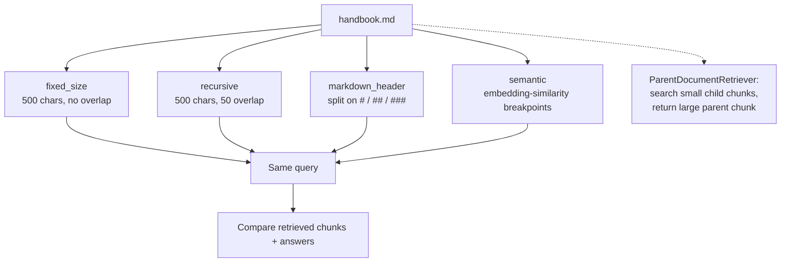

# 03 — Chunking Strategies: The Most Underrated RAG Decision

Converted from [`chunking_strategies.ipynb`](https://github.com/yashjainio/rag-youtube/blob/main/03_chunking_strategies/chunking_strategies.ipynb).
Code and outputs are copied unchanged from the notebook. The Architecture diagram is the
notebook's own, decoded from its image link; the tables and every paragraph marked **Note**
were added for this document.

**Contents**

- [03 — Chunking Strategies: The Most Underrated RAG Decision](#03--chunking-strategies-the-most-underrated-rag-decision)
  - [What you'll learn](#what-youll-learn)
  - [Architecture](#architecture)
  - [Setup](#setup)
  - [`chunkers` — the same handbook, split 4 different ways](#chunkers--the-same-handbook-split-4-different-ways)
  - [`compare` — same query, 4 chunkings, compare retrieval + answers](#compare--same-query-4-chunkings-compare-retrieval--answers)
  - [`parent_document_demo` — decoupling search chunk size from generation chunk size](#parent_document_demo--decoupling-search-chunk-size-from-generation-chunk-size)
  - [Run it end-to-end](#run-it-end-to-end)
  - [Key concepts](#key-concepts)
  - [Try this yourself](#try-this-yourself)
  - [Common pitfalls](#common-pitfalls)
  - [The Junebug handbook](#the-junebug-handbook)

## What you'll learn

Before anything gets embedded, it gets chunked — and that decision quietly caps your
retrieval quality more than almost any other choice in the pipeline. This notebook takes
one fictional 8-chapter technical handbook, splits it four different ways, and runs the
_same_ two queries against each resulting index so you can watch retrieval (and the final
answer) change while nothing else in the pipeline does.

## Architecture



**Note:** the components behind each stage of the diagram:

| Stage | Component | Settings |
| --- | --- | --- |
| Source document | `data/handbook.md` | 7,797 chars, 1,239 words |
| Embeddings | `OpenAIEmbeddings` | `text-embedding-3-small` |
| Comparison index | `InMemoryVectorStore` | One fresh store per strategy |
| Retrieval | `similarity_search` | `k=2` |
| Generation | `ChatOpenAI` | `gpt-5.4-nano`, `temperature=0` |
| Parent-document search index | `Chroma` | Collection `parent_doc_demo`, holds child chunks only |
| Parent-document store | `InMemoryStore` | Holds full parent chunks by id |

## Setup

Uses `OPENAI_API_KEY` from the shared `.env` at the repo root.

```python
from pathlib import Path
from dotenv import load_dotenv

# override=True so re-running this cell picks up edits to .env without restarting the kernel
load_dotenv(override=True)

HANDBOOK_PATH = Path("data") / "handbook.md"
```

**Note:** `HANDBOOK_PATH` is relative, so run the code from `03_chunking_strategies/`.

The code also needs four packages that this project doesn't have yet:

```bash
uv add langchain-text-splitters langchain-experimental langchain-chroma langchain-classic
```

## `chunkers` — the same handbook, split 4 different ways

Chunking is the most underrated decision in RAG: split too small and you lose context,
split too large and you drown the LLM in irrelevant text, split ignoring structure and you
cut a table or step-by-step procedure in half.

```python
from langchain_core.documents import Document
from langchain_experimental.text_splitter import SemanticChunker
from langchain_openai import OpenAIEmbeddings
from langchain_text_splitters import CharacterTextSplitter
from langchain_text_splitters import MarkdownHeaderTextSplitter
from langchain_text_splitters import RecursiveCharacterTextSplitter


def load_handbook_text() -> str:
    return HANDBOOK_PATH.read_text()


def fixed_size_chunks(text: str, size: int = 500) -> list[Document]:
    """Naive: cut every N characters, ignoring sentence/section boundaries."""
    # separator="" forces a hard cut at exactly `size` chars, mid-word if it lands there
    splitter = CharacterTextSplitter(separator="", chunk_size=size, chunk_overlap=0)
    return [Document(page_content=c) for c in splitter.split_text(text)]


def recursive_chunks(text: str, size: int = 500, overlap: int = 50) -> list[Document]:
    """Tries paragraph, then sentence, then word boundaries before hard-cutting."""
    # overlap keeps a little trailing context from the previous chunk so meaning
    # isn't lost when a sentence gets split right at the boundary
    splitter = RecursiveCharacterTextSplitter(chunk_size=size, chunk_overlap=overlap)
    return [Document(page_content=c) for c in splitter.split_text(text)]


def semantic_chunks(text: str) -> list[Document]:
    """Splits where embedding similarity between consecutive sentences drops —
    i.e. where the *topic* actually changes, not at a fixed character count."""
    embeddings = OpenAIEmbeddings(model="text-embedding-3-small")
    # percentile: flag a breakpoint wherever the similarity drop is in the top
    # percentile of drops seen across the whole doc, rather than a fixed threshold
    splitter = SemanticChunker(embeddings, breakpoint_threshold_type="percentile")
    return splitter.create_documents([text])


def markdown_header_chunks(text: str) -> list[Document]:
    """Splits on `#`/`##`/`###` headers, so a chunk never spans two sections
    and each chunk's metadata records which chapter/subsection it came from."""
    # each tuple is (markdown header syntax, metadata key) -- the splitter both cuts the
    # text at every occurrence of that header level AND stamps the resulting chunk's
    # metadata with the header text under that key, so a chunk "knows" which chapter/
    # section/subsection it came from without you having to track it separately
    headers = [("#", "chapter"), ("##", "section"), ("###", "subsection")]
    splitter = MarkdownHeaderTextSplitter(headers_to_split_on=headers)
    return splitter.split_text(text)
```

Output:

```text
/var/folders/3s/4kzjy6kd0h58f0cv6d05z7cr0000gn/T/ipykernel_2057/2186481907.py:2: DeprecationWarning: `langchain-experimental` is being sunset and is no longer actively maintained. See https://github.com/langchain-ai/langchain-experimental/issues/87 for details.
  from langchain_experimental.text_splitter import SemanticChunker
```

**Note:** the warning matters if you reuse this code: `SemanticChunker` comes from a package
that is no longer maintained.

| Strategy | Splits on | Size control | Overlap | Extra cost |
| --- | --- | --- | --- | --- |
| `fixed_size_chunks` | Every 500 characters | Hard limit | 0 | None |
| `recursive_chunks` | Paragraph, sentence, then word | Up to 500 characters | 50 | None |
| `markdown_header_chunks` | `#`, `##`, `###` headers | None, follows sections | 0 | None |
| `semantic_chunks` | Drops in sentence similarity | None, follows topics | 0 | Embeds every sentence |

Compare the chunk counts and sizes:

```python
text = load_handbook_text()
print(f"Handbook length: {len(text)} chars, {len(text.split())} words\n")

for name, chunks in [
    ("fixed_size", fixed_size_chunks(text)),
    ("recursive", recursive_chunks(text)),
    ("markdown_header", markdown_header_chunks(text)),
]:
    # compare chunk-size spread across strategies - fixed_size should be near-uniform,
    # the others will vary because they respect natural boundaries
    sizes = [len(c.page_content) for c in chunks]
    print(f"{name:16s} -> {len(chunks):3d} chunks, sizes {min(sizes)}-{max(sizes)} chars")

print("\n(semantic_chunks skipped here — it costs an embedding call per")
print(" sentence; it's used against real queries in the compare section below.)")
```

Output:

```text
Handbook length: 7797 chars, 1239 words

fixed_size       ->  16 chunks, sizes 296-500 chars
recursive        ->  23 chunks, sizes 134-490 chars
markdown_header  ->  18 chunks, sizes 212-766 chars

(semantic_chunks skipped here — it costs an embedding call per
 sentence; it's used against real queries in the compare section below.)
```

## `compare` — same query, 4 chunkings, compare retrieval + answers

Run the SAME query against 4 different chunkings of the same document and print what each
retrieves + what the LLM answers from it. This is the payoff of the episode: watch
retrieval quality change live as only the chunking strategy changes, nothing else.

```python
from langchain_core.vectorstores import InMemoryVectorStore
from langchain_openai import ChatOpenAI, OpenAIEmbeddings

QUERIES = [
    "When should the robot's wheels be replaced?",
    "What happens if two robots both want the same pod?",
]

ANSWER_PROMPT = """Answer using ONLY this context. Be concise.

Context:
{context}

Question: {question}
Answer:"""


def build_store(chunks) -> InMemoryVectorStore:
    # fresh in-memory store per strategy so results aren't mixed across chunking approaches
    embeddings = OpenAIEmbeddings(model="text-embedding-3-small")
    store = InMemoryVectorStore(embeddings)
    store.add_texts([c.page_content for c in chunks])
    return store


def answer_with_strategy(store: InMemoryVectorStore, query: str, llm: ChatOpenAI) -> tuple[str, list[str]]:
    results = store.similarity_search(query, k=2)
    context = "\n---\n".join(d.page_content for d in results)
    answer = llm.invoke(ANSWER_PROMPT.format(context=context, question=query)).content
    # truncate + flatten newlines just for readable console output, not passed to the LLM
    return answer, [d.page_content[:100].replace("\n", " ") for d in results]
```

**Note:** `build_store` passes only `page_content` to the store, so the chapter and section
metadata from `markdown_header_chunks` never reaches retrieval. The header text is also
missing from those chunks: in the output below, the `markdown_header` chunk starts at "Wheel
wear is measured", while the `recursive` chunk keeps "### 6.1 Wheel Wear Thresholds".

```python
from langchain_openai import ChatOpenAI

llm = ChatOpenAI(model="gpt-5.4-nano", temperature=0)

strategies = {
    "fixed_size (500 chars, no overlap)": fixed_size_chunks(text),
    "recursive (500 chars, 50 overlap)": recursive_chunks(text),
    "markdown_header (split on # / ## / ###)": markdown_header_chunks(text),
    "semantic (embedding-similarity breakpoints)": semantic_chunks(text),
}

# build one vector store per strategy so the same query can be run against each independently
stores = {name: build_store(chunks) for name, chunks in strategies.items()}

for query in QUERIES:
    print("=" * 70)
    print(f"QUERY: {query}")
    print("=" * 70)
    for name, store in stores.items():
        answer, snippets = answer_with_strategy(store, query, llm)
        print(f"\n[{name}]")
        for s in snippets:
            print(f"  retrieved: ...{s}...")
        print(f"  answer: {answer}")
    print()
```

Output:

```text
======================================================================
QUERY: When should the robot's wheels be replaced?
======================================================================

[fixed_size (500 chars, no overlap)]
  retrieved: ...e maintenance is split into three tiers:  - **Daily**: visual inspection for debris in wheel wells, ...
  retrieved: ...ion on polished concrete degrades enough to trigger more frequent E-522 motor stall codes, so wheels...
  answer: When tread depth falls below 3.5mm.

[recursive (500 chars, 50 overlap)]
  retrieved: ...### 6.1 Wheel Wear Thresholds  Wheel wear is measured by tread depth in millimeters. New wheels ship...
  retrieved: ...Routine maintenance is split into three tiers:  - **Daily**: visual inspection for debris in wheel w...
  answer: When the tread depth falls below 3.5mm.

[markdown_header (split on # / ## / ###)]
  retrieved: ...Wheel wear is measured by tread depth in millimeters. New wheels ship at 8mm tread depth. Below 3mm,...
  retrieved: ...Routine maintenance is split into three tiers:   - **Daily**: visual inspection for debris in wheel ...
  answer: When the tread depth falls below 3.5mm.

[semantic (embedding-similarity breakpoints)]
  retrieved: ...Release units from dock in batches of 5 to avoid a startup current spike. 5. Watch the first lap of ...
  retrieved: ...# Junebug Fleet Operations Handbook  *Internal technical reference for warehouse operators running t...
  answer: When the tread depth drops below 3.5 mm to stay ahead of traction failures.

======================================================================
QUERY: What happens if two robots both want the same pod?
======================================================================

[fixed_size (500 chars, no overlap)]
  retrieved: ...8: Frequently Asked Questions  **Q: Can Gen 1 units run the newest HiveMind firmware?** A: No. Gen 1...
  retrieved: ...ported to support.  ## Chapter 3: Picking Zone Coordination  Picking zones are divided into hexagona...
  answer: HiveMind uses a claim-token system — the first robot to reach the pod's RFID tag wins the claim, and the second robot is automatically reassigned to the next pod.

[recursive (500 chars, 50 overlap)]
  retrieved: ...**Q: What happens if two robots are assigned the same pod?** A: HiveMind uses a claim-token system —...
  retrieved: ...## Chapter 3: Picking Zone Coordination  Picking zones are divided into hexagonal cells, each roughl...
  answer: HiveMind uses a claim-token system — the first robot to reach the pod's RFID tag wins the claim, and the second robot is automatically reassigned to the next pod in its queue within about 2 seconds.

[markdown_header (split on # / ## / ###)]
  retrieved: ...**Q: Can Gen 1 units run the newest HiveMind firmware?** A: No. Gen 1 units are capped at firmware b...
  retrieved: ...Picking zones are divided into hexagonal cells, each roughly 4 meters across, to allow efficient mul...
  answer: HiveMind uses a claim-token system — the first robot to reach the pod's RFID tag wins the claim, and the second robot is automatically reassigned to the next pod in its queue within about 2 seconds.

[semantic (embedding-similarity breakpoints)]
  retrieved: ...Release units from dock in batches of 5 to avoid a startup current spike. 5. Watch the first lap of ...
  retrieved: ...# Junebug Fleet Operations Handbook  *Internal technical reference for warehouse operators running t...
  answer: HiveMind uses a claim-token system— the first robot to reach the pod's RFID tag wins the claim, and the second robot is automatically reassigned to the next pod in its queue within about 2 seconds.

```

**Note:** all four strategies answered both queries, so this run doesn't separate them by
final answer. The differences are in what was retrieved:

- **`fixed_size`:** the first wheel snippet starts mid-word ("e maintenance"), showing the
  hard cut. Its pod answer is the only one that leaves out "within about 2 seconds".
- **`recursive` and `markdown_header`:** retrieved chunks start at clean boundaries and
  give the full pod answer.
- **`semantic`:** both queries retrieved the same two chunks. One starts at the top of the
  handbook and the other at step 4 of Chapter 2. Both answers still came out right, so
  those chunks must be large enough to contain Chapters 6 and 8. That's an inference from
  the output, because the notebook never prints semantic chunk sizes. Large chunks like
  these send much more text to the LLM for each query.

## `parent_document_demo` — decoupling search chunk size from generation chunk size

Retrieval and generation want different chunk sizes. Small chunks embed precisely (good for
search); large chunks give the LLM enough surrounding context (good for generation).
`ParentDocumentRetriever` searches over small "child" chunks but returns their full
"parent" chunk to the LLM, getting both.

```python
from langchain_chroma import Chroma
from langchain_classic.retrievers import ParentDocumentRetriever
from langchain_classic.storage import InMemoryStore
from langchain_core.documents import Document
from langchain_openai import OpenAIEmbeddings
from langchain_text_splitters import RecursiveCharacterTextSplitter


def build_parent_document_retriever() -> ParentDocumentRetriever:
    # small child chunks give precise vector-search matches; large parent chunks
    # give the LLM enough surrounding context once a child chunk is matched
    parent_splitter = RecursiveCharacterTextSplitter(chunk_size=1500, chunk_overlap=0)
    child_splitter = RecursiveCharacterTextSplitter(chunk_size=250, chunk_overlap=0)

    vectorstore = Chroma(
        collection_name="parent_doc_demo",
        embedding_function=OpenAIEmbeddings(model="text-embedding-3-small"),
    )
    # docstore holds the full parent chunks by id; only the small child chunks get embedded
    docstore = InMemoryStore()

    retriever = ParentDocumentRetriever(
        vectorstore=vectorstore,
        docstore=docstore,
        child_splitter=child_splitter,
        parent_splitter=parent_splitter,
    )
    retriever.add_documents([Document(page_content=load_handbook_text())])
    return retriever
```

```python
retriever = build_parent_document_retriever()
query = "When should the robot's wheels be replaced?"

# What the vector search actually matched against (small, precise)
child_hits = retriever.vectorstore.similarity_search(query, k=1)
print(f"Query: {query}\n")
print(f"Matched CHILD chunk ({len(child_hits[0].page_content)} chars):")
print(f"  {child_hits[0].page_content!r}\n")

# What actually gets returned to the LLM (larger, more context)
parent_hits = retriever.invoke(query)
print(f"Returned PARENT chunk ({len(parent_hits[0].page_content)} chars):")
print(f"  {parent_hits[0].page_content[:300]!r}...")
```

Output:

```text
Query: When should the robot's wheels be replaced?

Matched CHILD chunk (138 chars):
  'motor stall codes, so wheels should be scheduled for replacement at the 3.5mm mark to stay\nahead of failures rather than reacting to them.'

Returned PARENT chunk (1152 chars):
  "If a firmware update causes elevated error rates (more than double the 7-day rolling\naverage for any error code), HiveMind automatically halts the rollout and reverts affected\nunits to the previous known-good firmware version. Manual rollback can be triggered from\nthe dashboard's Fleet > Firmware > "...
```

**Note:** the search matched 138 characters and the LLM would get 1,152. The parent begins
in Chapter 5.1 because parents are cut by size, not by section, so it also carries firmware
rollback text that has nothing to do with wheels.

## Run it end-to-end

Running the cells above top to bottom already reproduces what `main.py` used to do: chunk
counts/sizes per strategy, the same-query comparison across all 4 chunkings, and the
`ParentDocumentRetriever` demo. The cell below just re-confirms all three steps ran.

```python
print("STEP 1 done: chunk counts/sizes computed for 4 strategies")
print("STEP 2 done: compared retrieval + answers across", len(QUERIES), "queries")
print("STEP 3 done: ParentDocumentRetriever child vs parent chunk shown")
```

**Note:** this cell has no saved output in the notebook, and its messages are fixed text
rather than checks. Step 1 says 4 strategies, but the sizing cell measures only 3 because it
skips `semantic_chunks`. `main.py` isn't in the upstream `03_chunking_strategies/` folder.

## Key concepts

1. **Why chunk at all** — embeddings represent a fixed amount of text well; whole documents
   dilute meaning, so you split before embedding.
2. **Fixed-size vs. recursive vs. semantic vs. header-aware splitting** — fixed-size ignores
   structure entirely; recursive respects paragraph/sentence boundaries; semantic splits
   where meaning actually shifts; header-aware never crosses a section boundary.
3. **Chunk size & overlap trade-offs** — bigger chunks carry more context but dilute
   precision; overlap protects against cutting a fact exactly at a boundary, at the cost of
   redundant storage.
4. **Parent-document retriever pattern** — decouple the chunk size used for _search_
   (small, precise) from the chunk size returned for _generation_ (large, contextful).

## Try this yourself

1. Change `fixed_size_chunks(text, size=500)` to `size=100` and see the answer quality
   degrade — you're now cutting mid-sentence constantly.
2. Add a 3rd query about the error-code table (Chapter 4) and see which strategy handles a
   markdown table best — tables are a classic chunking failure case (full topic in
   Episode 06).
3. In `build_parent_document_retriever`, shrink `parent_splitter` to `chunk_size=400` and
   observe how much less "extra" context the LLM gets back per retrieved match.

## Common pitfalls

- **Using the same chunk size for every document type** — a legal contract and a chat log
  deserve different chunk sizes; there's no universal default.
- **Overlap as a substitute for good boundaries** — overlap reduces the _chance_ of cutting
  a fact in half, it doesn't fix a splitter that ignores document structure entirely.
- **Semantic chunking cost** — it makes one embedding call per sentence to find breakpoints,
  which is slower and more expensive than the other three strategies; reserve it for corpora
  where retrieval quality matters more than ingestion cost.

## The Junebug handbook

**Note:** the notebook reads one file, [`data/handbook.md`](../data/handbook.md), copied
unchanged from the [upstream repo](https://github.com/yashjainio/rag-youtube/blob/main/03_chunking_strategies/data/handbook.md).
It's a fictional operations manual for a warehouse robot fleet, so the base LLM can't answer
from prior knowledge. Its mix of prose, numbered steps, bullets, a table and a Q&A list gives
each splitter something different to get wrong.

| Chapter | Topic | Used by |
| --- | --- | --- |
| 1 | Fleet overview, hardware generations, battery and charging | |
| 2 | Daily startup procedure and common failures | |
| 3 | Picking zones, congestion, human safety zones | |
| 4 | Error code table and escalation policy | Try this yourself, step 2 |
| 5 | Software updates and rollback | |
| 6 | Maintenance schedule and wheel wear thresholds | Wheel query |
| 7 | Decommissioning and data wipe | |
| 8 | Frequently asked questions | Pod query |
