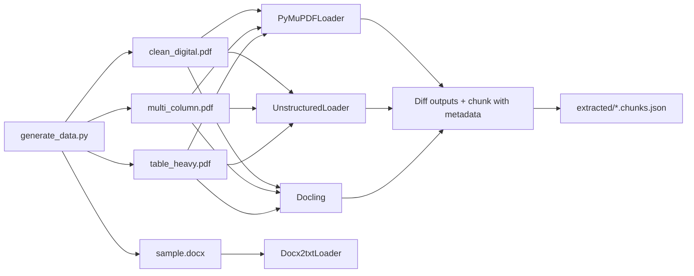

# 04 — Extracting Text from PDFs & Word Docs

Converted from [`pdf_docx_extraction.ipynb`](https://github.com/yashjainio/rag-youtube/blob/main/04_pdf_docx_extraction/pdf_docx_extraction.ipynb).
Code and outputs are copied from the notebook. The only cuts are RapidOCR `[INFO]` log lines
and `Loading weights` progress bars, which carry no results. The Architecture diagram is the
notebook's own, decoded from its image link; the tables and every paragraph marked **Note**
were added for this document.

**Contents**

- [04 — Extracting Text from PDFs & Word Docs](#04--extracting-text-from-pdfs--word-docs)
  - [What you'll learn](#what-youll-learn)
  - [Architecture](#architecture)
  - [Setup](#setup)
  - [Generate sample data](#generate-sample-data)
  - [`extractors` — three different ways to pull text out of the same PDF](#extractors--three-different-ways-to-pull-text-out-of-the-same-pdf)
  - [`compare` — run all 3 extractors, diff the results, chunk the best output](#compare--run-all-3-extractors-diff-the-results-chunk-the-best-output)
  - [Run it end-to-end](#run-it-end-to-end)
  - [Key concepts](#key-concepts)
  - [Try this yourself](#try-this-yourself)
  - [Common pitfalls](#common-pitfalls)
  - [The sample files](#the-sample-files)

## What you'll learn

Real documents are messy, and extraction quality puts a hard ceiling on RAG quality — no
amount of clever retrieval fixes text that was garbled on the way in. This notebook runs 3
different extractors (PyMuPDF, Unstructured, Docling) on the same PDFs — one clean, one
two-column, one table-heavy — and one DOCX file, diffs their output, and shows a flat-text
vs. structured-table extraction side by side.

## Architecture



**Note:** the diagram differs from the code in three places. `generate_data.py` is now the
"Generate sample data" cell. Only PyMuPDF's output is chunked, not all three. The DOCX text
from `Docx2txtLoader` is chunked too, though the diagram draws no edge from it.

| Stage | Component | Settings |
| --- | --- | --- |
| Sample data | `reportlab`, `python-docx` | 2 PDFs and 1 DOCX generated; `table_heavy.pdf` must be supplied |
| Flat extraction | `PyMuPDFLoader` | One Document per page, joined with blank lines |
| Layout extraction | `UnstructuredPDFLoader` | `mode="elements"` |
| Structured extraction | Docling `DocumentConverter` | `export_to_markdown()` |
| DOCX extraction | `Docx2txtLoader` | Plain text |
| Chunking | `RecursiveCharacterTextSplitter` | `chunk_size=500`, `chunk_overlap=50` |
| Output | JSON per source file | `data/extracted/<name>.chunks.json`, `metadata.source` |
| Generation | `ChatOpenAI` | `gpt-4.1-nano`, `temperature=0` |

## Setup

Uses `OPENAI_API_KEY` from the shared `.env` at the repo root.

```python
from pathlib import Path
from dotenv import load_dotenv

# override=True so re-running this cell picks up edits to .env without restarting the kernel
load_dotenv(override=True)

DATA_DIR = Path("data")
OUT_DIR = DATA_DIR / "extracted"
```

**Note:** `DATA_DIR` is relative, so run the code from `04_pdf_docx_extraction/`. The
project's `pyproject.toml` already has every package; run `uv sync`. Unstructured's PDF path
also needs poppler (`brew install poppler`). The local `pdf_docx_extraction_ollama.ipynb`
swaps the LLM for `ChatOllama(model="llama3.2", temperature=0, reasoning=False)`, so it needs
`ollama pull llama3.2` instead of an OpenAI key.

## Generate sample data

Creates 4 sample files this episode extracts text from: a clean single-column PDF, a
two-column PDF (harder to extract in reading order), a table-heavy PDF, and a DOCX. These
are gitignored — rerun this cell any time you need them back.

```python
from docx import Document as DocxDocument
from reportlab.lib import colors
from reportlab.lib.pagesizes import letter
from reportlab.lib.styles import getSampleStyleSheet
from reportlab.lib.units import inch
from reportlab.platypus import BaseDocTemplate
from reportlab.platypus import Frame
from reportlab.platypus import PageTemplate
from reportlab.platypus import Paragraph
from reportlab.platypus import SimpleDocTemplate
from reportlab.platypus import Table
from reportlab.platypus import TableStyle

STYLES = getSampleStyleSheet()


def make_clean_digital_pdf():
    # simplest case: single column, no tables — the baseline every extractor should handle
    path = DATA_DIR / "clean_digital.pdf"
    doc = SimpleDocTemplate(str(path), pagesize=letter)
    body = [
        Paragraph("Meridian Analytics — Q3 Platform Update", STYLES["Title"]),
        Paragraph(
            "Meridian Analytics shipped three major platform updates in Q3: a rewritten "
            "ingestion pipeline, a new anomaly-detection model, and a redesigned billing "
            "dashboard. Customer-reported latency on the ingestion pipeline dropped by "
            "41 percent after the rewrite, measured across the top 50 accounts by volume.",
            STYLES["BodyText"],
        ),
        Paragraph(
            "The anomaly-detection model, internally called Lighthouse, reduced false "
            "positive alerts from 1 in 12 to 1 in 47 during the beta period. Lighthouse "
            "will roll out to all paying customers in Q4.",
            STYLES["BodyText"],
        ),
    ]
    doc.build(body)
    print(f"wrote {path}")


def make_multi_column_pdf():
    path = DATA_DIR / "multi_column.pdf"
    doc = BaseDocTemplate(str(path), pagesize=letter)
    margin = 0.75 * inch
    # two frames side-by-side (with a 0.3" gutter between them) is what makes this a
    # true multi-column layout rather than one wide text block
    col_width = (letter[0] - 2 * margin - 0.3 * inch) / 2
    left_frame = Frame(margin, margin, col_width, letter[1] - 2 * margin, id="left")
    right_frame = Frame(margin + col_width + 0.3 * inch, margin, col_width, letter[1] - 2 * margin, id="right")
    doc.addPageTemplates([PageTemplate(id="TwoCol", frames=[left_frame, right_frame])])

    left_text = (
        "Left column: Meridian's support team resolved 2,300 tickets in Q3, an increase "
        "of 15 percent over Q2. Average first-response time held steady at 6 minutes "
        "despite the higher volume, largely due to the new triage-bot rollout in August."
    )
    right_text = (
        "Right column: Headcount grew from 84 to 96 employees in Q3. Two new hires joined "
        "the Lighthouse anomaly-detection team, and one new hire joined support. No "
        "departures were recorded in the quarter."
    )
    body = [
        Paragraph("Meridian Analytics — Internal Ops Digest", STYLES["Title"]),
        Paragraph(left_text, STYLES["BodyText"]),
        Paragraph(right_text, STYLES["BodyText"]),
    ]
    # naive PDF text extractors often read column 1 then column 2 out of order,
    # or interleave them line-by-line — that's the failure mode this file demos
    doc.build(body)
    print(f"wrote {path}")


def make_docx():
    path = DATA_DIR / "sample.docx"
    doc = DocxDocument()
    doc.add_heading("Meridian Analytics — Hiring Plan", level=1)
    doc.add_paragraph(
        "Meridian Analytics plans to hire 18 engineers in Q4, split evenly between the "
        "ingestion team and the Lighthouse anomaly-detection team."
    )
    doc.add_heading("Roles", level=2)
    for role in ["Senior Backend Engineer", "ML Engineer", "Platform SRE"]:
        doc.add_paragraph(role, style="List Bullet")
    doc.save(str(path))
    print(f"wrote {path}")


make_clean_digital_pdf()
make_multi_column_pdf()
make_docx()
print("\nDone. These 4 files are gitignored — rerun this cell any time.")
```

Output:

```text
wrote data/clean_digital.pdf
wrote data/multi_column.pdf
wrote data/table_heavy.pdf
wrote data/sample.docx

Done. These 4 files are gitignored — rerun this cell any time.
```

**Note:** the saved output doesn't match the code. The output lists `table_heavy.pdf`, but
the cell has no function that writes it, so a fresh run prints 3 `wrote` lines, not 4. The
unused imports `colors`, `Table` and `TableStyle` suggest a table generator was removed and the
output was never re-run. Before running the later cells, copy a PDF with a table into
`data/table_heavy.pdf` (see [The sample files](#the-sample-files)).

## `extractors` — three different ways to pull text out of the same PDF

Each with a different quality/speed/dependency trade-off:

- **PyMuPDFLoader**: fast, C-based, reads the PDF's raw text layer in left-to-right,
  top-to-bottom order per page. Struggles with multi-column layouts and drops table
  structure.
- **UnstructuredLoader**: layout-aware (detects columns, titles, list items), slower, more
  dependencies, better structure preservation.
- **Docling**: IBM's document-understanding model; best at tables and complex layouts,
  slowest of the three.

```python
from pathlib import Path


def extract_with_pymupdf(pdf_path: Path) -> str:
    # imported lazily inside the function so this cell can run even if an extractor's
    # heavy optional dependency isn't installed, as long as you don't call that one
    from langchain_community.document_loaders import PyMuPDFLoader

    docs = PyMuPDFLoader(str(pdf_path)).load()
    return "\n\n".join(d.page_content for d in docs)


def extract_with_unstructured(pdf_path: Path) -> str:
    from langchain_community.document_loaders import UnstructuredPDFLoader

    # mode="elements" keeps each detected layout element (title, table, list item, ...)
    # as its own Document instead of flattening the whole page into one blob
    docs = UnstructuredPDFLoader(str(pdf_path), mode="elements").load()
    return "\n\n".join(d.page_content for d in docs)


def extract_with_docling(pdf_path: Path) -> str:
    from docling.document_converter import DocumentConverter

    converter = DocumentConverter()
    result = converter.convert(str(pdf_path))
    # markdown output preserves table/heading structure that plain-text extractors lose
    return result.document.export_to_markdown()


def extract_docx(docx_path: Path) -> str:
    from langchain_community.document_loaders import Docx2txtLoader

    docs = Docx2txtLoader(str(docx_path)).load()
    return "\n\n".join(d.page_content for d in docs)
```

| Function | Loader | Returns | Keeps structure |
| --- | --- | --- | --- |
| `extract_with_pymupdf` | `PyMuPDFLoader` | Page texts joined with blank lines | No |
| `extract_with_unstructured` | `UnstructuredPDFLoader(mode="elements")` | Element texts joined with blank lines | Element boundaries only; the type labels stay in metadata, which is dropped |
| `extract_with_docling` | `DocumentConverter` | Markdown | Headings and tables |
| `extract_docx` | `Docx2txtLoader` | Plain text | No |

## `compare` — run all 3 extractors, diff the results, chunk the best output

Chunk the best output with metadata (source file) and write it to `extracted/chunks.json`.
Finally, show a bad-extraction-in / bad-answer-out vs good-extraction-in / good-answer-out
comparison on the table-heavy PDF.

**Note:** the code chunks PyMuPDF's output, not the best one. It writes one file per source,
`data/extracted/<name>.chunks.json`, not a single `extracted/chunks.json`.

```python
import json
from pathlib import Path
from langchain_openai import ChatOpenAI
from langchain_text_splitters import RecursiveCharacterTextSplitter

# {text} (not {context}) to match the .format(text=..., question=...) call below
ANSWER_PROMPT = """Answer using ONLY the extracted text below. Be concise.

Extracted text:
{text}

Question: {question}
Answer:"""


def diff_extractors(pdf_path: Path):
    print(f"\n--- {pdf_path.name} ---")
    results = {}
    for name, fn in [
        ("pymupdf", extract_with_pymupdf),
        ("unstructured", extract_with_unstructured),
        ("docling", extract_with_docling),
    ]:
        try:
            text = fn(pdf_path)
            results[name] = text
            print(f"  {name:14s} -> {len(text):5d} chars")
        except Exception as e:  # extractors have heavy optional deps; report and continue
            print(f"  {name:14s} -> FAILED: {e}")
    return results


def chunk_and_save(pdf_name: str, text: str):
    OUT_DIR.mkdir(exist_ok=True)
    splitter = RecursiveCharacterTextSplitter(chunk_size=500, chunk_overlap=50)
    # tag each chunk with its source filename so downstream retrieval can cite provenance
    chunks = [{"text": c, "metadata": {"source": pdf_name}} for c in splitter.split_text(text)]
    out_path = OUT_DIR / f"{Path(pdf_name).stem}.chunks.json"
    out_path.write_text(json.dumps(chunks, indent=2))
    print(f"  wrote {len(chunks)} chunks -> {out_path}")


def bad_vs_good_extraction_demo():
    """pymupdf reads table cells as one flat left-to-right text stream —
    "Q1 4.2 31 2.1 Q2 4.9 ..." — with no row/column structure at all. On this
    small 4-column table an LLM can usually still untangle it correctly, but
    that's luck, not a guarantee: the row/column association only survives
    because nothing reordered the cells during extraction. docling instead
    exports proper markdown table syntax, so the LLM never has to guess which
    number belongs to which column. Bigger or merged-cell tables (Episode 06)
    are where the flat version actually starts giving wrong answers."""
    pdf_path = DATA_DIR / "table_heavy.pdf"
    question = "For the Low Vision category, how many ballots were completed, what was the accuracy, and how long did they take to complete?"
    llm = ChatOpenAI(model="gpt-4.1-nano", temperature=0)

    flat_text = extract_with_pymupdf(pdf_path)
    structured_text = extract_with_docling(pdf_path)

    print(f"\nQuestion: {question}")
    for label, text in [
        ("pymupdf (flat, structure lost)", flat_text),
        ("docling (structured markdown table)", structured_text),
    ]:
        answer = llm.invoke(ANSWER_PROMPT.format(text=text, question=question)).content
        print(f"\n[{label}]")
        print(f"  extracted: {text[:150]!r}...")
        print(f"  answer: {answer}")
```

**Note:** `chunk_and_save` splits the joined text, so the page number each loader records is
lost. Only `source` reaches the chunk metadata — the exact pitfall listed under
[Common pitfalls](#common-pitfalls).

```python
for pdf_name in ["clean_digital.pdf", "multi_column.pdf", "table_heavy.pdf"]:
    results = diff_extractors(DATA_DIR / pdf_name)
    # only pymupdf's output gets chunked/saved here; it's the baseline used for
    # downstream retrieval, while unstructured/docling are just compared above
    if "pymupdf" in results:
        chunk_and_save(pdf_name, results["pymupdf"])

print("\n--- sample.docx ---")
docx_text = extract_docx(DATA_DIR / "sample.docx")
print(f"  docx2txt -> {len(docx_text)} chars")
chunk_and_save("sample.docx", docx_text)
```

Output:

```text

--- clean_digital.pdf ---
  pymupdf        ->   534 chars
Warning: No languages specified, defaulting to English.
  unstructured   ->   537 chars
  docling        ->   539 chars
  wrote 2 chunks -> data/extracted/clean_digital.chunks.json

--- multi_column.pdf ---
  pymupdf        ->   472 chars
Warning: No languages specified, defaulting to English.
  unstructured   ->   474 chars
  docling        ->   475 chars
  wrote 1 chunks -> data/extracted/multi_column.chunks.json

--- table_heavy.pdf ---
  pymupdf        ->   394 chars
Warning: No languages specified, defaulting to English.
  unstructured   ->    91 chars
  docling        ->  1153 chars
  wrote 1 chunks -> data/extracted/table_heavy.chunks.json

--- sample.docx ---
  docx2txt -> 228 chars
  wrote 1 chunks -> data/extracted/sample.chunks.json
```

**Note:** the character counts in one table:

| File | PyMuPDF | Unstructured | Docling | Chunks saved |
| --- | --- | --- | --- | --- |
| `clean_digital.pdf` | 534 | 537 | 539 | 2 |
| `multi_column.pdf` | 472 | 474 | 475 | 1 |
| `table_heavy.pdf` | 394 | 91 | 1,153 | 1 |
| `sample.docx` | 228 (docx2txt) | | | 1 |

The two text-only PDFs come out within 5 characters across all three extractors, so counts
alone can't show the reading-order problem `multi_column.pdf` was built for; you have to read
the text. The table PDF is where they split. Unstructured kept only 91 characters, so most of
the table is gone. Docling's 1,153 includes the spaces and `|` characters that pad its
Markdown table, so it isn't 3 times more content. `clean_digital.pdf` makes 2 chunks because
534 characters is over the 500 limit.

## Run it end-to-end

Mirrors what `main.py` used to do: diff all 3 extractors across the 3 sample PDFs (above),
then run the bad-extraction-vs-good-extraction comparison on the table-heavy PDF.

```python
print("=" * 70)
print("BAD EXTRACTION -> BAD ANSWER  vs  GOOD EXTRACTION -> GOOD ANSWER")
print("=" * 70)
bad_vs_good_extraction_demo()
```

Output:

```text
======================================================================
BAD EXTRACTION -> BAD ANSWER  vs  GOOD EXTRACTION -> GOOD ANSWER
======================================================================

Question: For the Low Vision category, how many ballots were completed, what was the accuracy, and how long did they take to complete?

[pymupdf (flat, structure lost)]
  extracted: 'Example table \nThis is an example of a data table. \nDisability \nCategory \nParticipants \nBallots \nCompleted \nBallots \nIncomplete/ \nTerminated \nResults '...
  answer: 2 ballots completed, 98.3% accuracy, 1716 seconds to complete.

[docling (structured markdown table)]
  extracted: '## Example table\n\nThis is an example of a data table.\n\n| Disability Category   |   Participants |   Ballots Completed |   Ballots Incomplete/ Terminat'...
  answer: 2 ballots completed, 98.3% accuracy, 1716 sec to complete.
```

**Note:** both answers are the same, so this run doesn't show a bad answer despite the
banner. The function's docstring says to expect that on a small table. The extracts still
show the difference. PyMuPDF splits every header cell onto its own line ("Disability",
"Category", "Participants"), and the LLM has to rebuild which value belongs to which column.
Docling keeps the header as one Markdown row. `main.py` isn't in the upstream
`04_pdf_docx_extraction/` folder.

## Key concepts

1. **PDF text layer vs. scanned PDFs** — a "digital" PDF has an embedded text layer you can
   extract directly; a scanned PDF is just an image and needs OCR (Episode 05).
2. **PyMuPDFLoader vs. UnstructuredLoader vs. Docling** — speed/dependency-weight vs.
   layout-awareness vs. table/structure fidelity; there's no single best choice.
3. **Preserving structure** — headings, lists, and especially tables carry meaning through
   their structure, not just their characters; flat extraction throws that away.
4. **Metadata capture for citations** — page numbers and source filenames captured at
   extraction time are what let a RAG answer later say "[source, page 2]" (Episode 09).

## Try this yourself

1. Open `multi_column.pdf` after generating it and compare the reading order PyMuPDF
   produces against the actual left-column-then-right-column layout — is it correct here?
   Try making the columns visually more similar in the data-generation cell to see it break.
2. Check whether `pymupdf`'s flat table extraction and `docling`'s structured extraction
   give the LLM the same answer — then imagine a table with 20 rows instead of 3 (that's
   Episode 06's failure case).
3. Add a 5th sample file with nested bullet lists and see which extractor preserves the
   nesting level in its output.

## Common pitfalls

- **Assuming one extractor is always best** — Docling's table/layout fidelity comes at a
  real speed cost; for a corpus of clean single-column PDFs, PyMuPDF alone is often enough.
- **Throwing away page numbers during chunking** — once you split into chunks, retroactively
  figuring out "which page was this from" is hard; capture it as metadata at extraction time.
- **Treating extraction as a one-time step** — if your source documents change format
  (e.g. a vendor switches from clean PDFs to scanned ones), your extraction quality can
  silently degrade without any code change.

## The sample files

**Note:** all four inputs are gitignored under `04_pdf_docx_extraction/data/`. Three come from
the Generate sample data cell and describe the fictional company Meridian Analytics, so the
base LLM can't answer from prior knowledge. Upstream doesn't ship `table_heavy.pdf`.

| File | Source | Content | Tests |
| --- | --- | --- | --- |
| `clean_digital.pdf` | `make_clean_digital_pdf` | Title and 2 paragraphs: Q3 platform update | The baseline every extractor should get right |
| `multi_column.pdf` | `make_multi_column_pdf` | Title and 2 columns: support tickets, headcount | Reading order across columns |
| `table_heavy.pdf` | Not generated; supply your own | Per the demo output: an "Example table" of ballot results by disability category | Table structure; the demo asks about the Low Vision row |
| `sample.docx` | `make_docx` | Hiring plan heading, a paragraph, a 3-item bulleted list | DOCX extraction |

To reproduce the demo question, `table_heavy.pdf` needs a table with a Low Vision row that has
ballots completed, accuracy and time to complete. Any PDF with a table works if you also
change `question` in `bad_vs_good_extraction_demo`.
