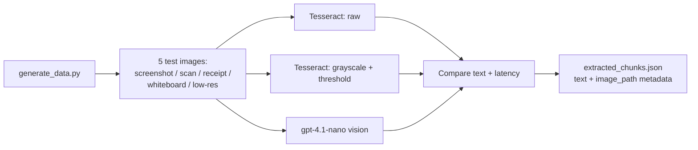
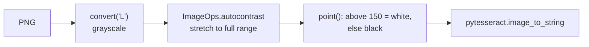

# 05 — Extracting Text from Images & Scanned Docs (OCR + Vision LLMs)

Converted from [`ocr_vision_extraction.ipynb`](https://github.com/yashjainio/rag-youtube/blob/main/05_ocr_vision_extraction/ocr_vision_extraction.ipynb).
Code and outputs are copied unchanged from the notebook. The Architecture diagram is the
notebook's own, decoded from its image link; the tables and every paragraph marked **Note**
were added for this document.

**Contents**

- [05 — Extracting Text from Images \& Scanned Docs (OCR + Vision LLMs)](#05--extracting-text-from-images--scanned-docs-ocr--vision-llms)
  - [Quick revision](#quick-revision)
  - [What you'll learn](#what-youll-learn)
  - [Architecture](#architecture)
  - [Setup](#setup)
  - [Generate sample data](#generate-sample-data)
  - [`ocr_extract` — classic OCR with Tesseract](#ocr_extract--classic-ocr-with-tesseract)
  - [`vision_llm_extract` — transcribe images with a vision LLM](#vision_llm_extract--transcribe-images-with-a-vision-llm-instead-of-classic-ocr)
  - [`compare` — Tesseract vs. vision LLM on all 5 images](#compare--tesseract-raw--preprocessed-vs-vision-llm-on-all-5-images)
  - [Run it end-to-end](#run-it-end-to-end)
  - [Key concepts](#key-concepts)
  - [Try this yourself](#try-this-yourself)
  - [Common pitfalls](#common-pitfalls)
  - [The sample images](#the-sample-images)

## Quick revision

**In one line:** when the source is pixels, not text, you either pattern-match the glyphs
(OCR) or ask a vision LLM to read the image. OCR is free and about 10 times faster; the
vision LLM copes with bad images but costs money per call and can still misread.

**What we learned**

- Five synthetic images, three extraction methods each:

  | Image | Tesseract raw | Tesseract preprocessed | Vision LLM |
  | --- | --- | --- | --- |
  | `clean_screenshot.png` | Mangles the `"""` quotes | Mangles the `"""` quotes | Exact |
  | `scanned_page.png` | Correct | Correct | Correct |
  | `receipt.png` | `TOTAL 2117` (lost the decimal point) | `TOTAL 21.17`, but `tgal` for `1gal` | Correct |
  | `whiteboard.png` | Correct | Correct | Correct |
  | `low_res_scan.png` | Garbage | Garbage | Readable, but order `86213` instead of `88213` |

- Tesseract took about 0.1 s per image; the vision LLM took 1.0–1.4 s.
- Only the low-res scan really separated the methods. The "whiteboard" is typed text with
  a slight tilt and blur, not handwriting, so Tesseract read it perfectly.

**Why it matters**

- Screenshots, scanned forms, receipts and whiteboard photos have no text layer, so the
  PDF extractors from Episode 04 return nothing useful.
- A vision LLM's mistakes look plausible. The wrong order number reads like a real one,
  while Tesseract's garbage is obviously wrong.
- At scale, per-image cost and latency decide which method you can afford.

**How the code does it**

| Function | What it does |
| --- | --- |
| `make_*()` | Draw 5 test images with Pillow, adding rotation, noise, blur or downsampling |
| `ocr_raw()` | `pytesseract.image_to_string` on the image as is |
| `ocr_preprocessed()` | Grayscale, `autocontrast`, a hard black/white cutoff at 150, then Tesseract |
| `vision_transcribe()` | Base64-encodes the PNG and sends it with a "transcribe exactly" prompt to `gpt-4.1-nano` in one multimodal `HumanMessage` |
| `compare_one()` | Runs all three on one image and times each |
| Final cell | Saves the vision LLM text for every image to `data/extracted_chunks.json` with `image_path` and `extraction_method` metadata |

**How to choose**

| Situation | Use |
| --- | --- |
| Clean screenshots and scans, large batches | Tesseract: free, local, fast |
| Faint or noisy scans | Tesseract with preprocessing, but check it helps; here it fixed one number and broke another |
| Low resolution, skew, real handwriting | A vision LLM, and spot-check numbers it returns |
| You want the gist, not the exact text | A vision LLM with a "describe" prompt instead of "transcribe" |

**Remember**

- Preprocessing isn't free accuracy. A fixed threshold of 150 fixed the receipt total but
  turned `1gal` into `tgal`, and made the low-res scan worse.
- `temperature=0` didn't give identical vision output: the receipt's dashed line and the
  capital "I" in "Item" changed between two runs.
- The code saves the vision LLM text for every image, not the best of the three.
- Images go to the model as base64 data URIs, not file paths.

**Run it**

- Needs Tesseract installed on the system (`brew install tesseract`) and `OPENAI_API_KEY`
  for the vision model.
- The fonts come from macOS paths. On other systems the code falls back to Pillow's bitmap
  font, and the results will differ from the ones below.

**Self-check**

<details>
<summary>1. Why did Tesseract read the "whiteboard" perfectly?</summary>

It's typed Arial text with a 2° tilt and a light blur, not handwriting. Tesseract handles
that easily; real marker handwriting would be much harder.
</details>

<details>
<summary>2. Which method made the most dangerous mistake on the low-res scan, and why?</summary>

The vision LLM. It returned a clean-looking but wrong order number (`86213` for `88213`).
Tesseract's output was obviously garbage, so nobody would trust it.
</details>

<details>
<summary>3. When is paying for a vision LLM a waste?</summary>

On large batches of clean screenshots or scans, which Tesseract reads for free in about a
tenth of the time.
</details>

## What you'll learn

Some source material only exists as pixels — screenshots, scanned forms, photographed
receipts and whiteboards. This notebook pulls text out of 5 synthetic test images spanning
that difficulty spectrum, using two fundamentally different approaches: classic OCR
(Tesseract, pattern-matches glyphs) and a vision LLM (gpt-4.1-nano, reasons about the
image). You'll see where each wins and what it costs.

## Architecture



**Note:** `generate_data.py` is now the "Generate sample data" cell. Only the vision LLM's
text reaches `extracted_chunks.json`, although the diagram draws all three methods into the
comparison.

| Stage | Component | Settings |
| --- | --- | --- |
| Sample data | Pillow (`PIL`) | 5 PNGs, macOS system fonts, `random.seed(42)` |
| Classic OCR | `pytesseract` | Default Tesseract settings |
| OCR preprocessing | `ImageOps.autocontrast`, `Image.point` | Grayscale, fixed threshold 150 |
| Vision transcription | `ChatOpenAI` | `gpt-4.1-nano`, `temperature=0`, base64 PNG |
| Output | JSON | `data/extracted_chunks.json`, metadata `image_path`, `extraction_method` |

## Setup

Uses `OPENAI_API_KEY` from the shared `.env` at the repo root. This episode also requires
`tesseract` to be installed locally (it's included via `conda-forge` in `environment.yml`).

```python
from pathlib import Path
from dotenv import load_dotenv

# override=True so re-running this cell picks up edits to .env without restarting the kernel
load_dotenv(override=True)

DATA_DIR = Path("data")
OUT_PATH = DATA_DIR / "extracted_chunks.json"
```

**Note:** `DATA_DIR` is relative, so run the code from `05_ocr_vision_extraction/`. This
repo uses uv, not conda, so there's no `environment.yml`. `pytesseract` and `pillow` are
already in `pyproject.toml`, but `pytesseract` only wraps the Tesseract program, which you
install separately:

```bash
brew install tesseract
```

## Generate sample data

Synthesizes 5 test images covering the OCR difficulty spectrum: a clean screenshot, a
"scanned" page (rotated + noisy), a receipt, a whiteboard photo (angled, marker-like
strokes), and a low-res scan (blurred + downsampled). These are gitignored — rerun this
cell any time you need them back.

```python
from pathlib import Path
from PIL import Image
from PIL import ImageDraw
from PIL import ImageFilter
from PIL import ImageFont
import random

random.seed(42)  # deterministic jitter so the whiteboard demo looks the same on every run


def _font(size: int) -> ImageFont.ImageFont:
    # try real system fonts first — PIL's bitmap default font looks nothing like real text
    # and would make OCR/vision comparisons meaningless
    for candidate in ["/System/Library/Fonts/Supplemental/Arial.ttf", "/System/Library/Fonts/Helvetica.ttc"]:
        if Path(candidate).exists():
            return ImageFont.truetype(candidate, size)
    return ImageFont.load_default()


def make_clean_screenshot():
    img = Image.new("RGB", (700, 300), "white")
    draw = ImageDraw.Draw(img)
    lines = [
        "def calculate_total(items):",
        '    """Sum item prices after a 7% tax."""',
        "    subtotal = sum(item.price for item in items)",
        "    return round(subtotal * 1.07, 2)",
    ]
    for i, line in enumerate(lines):
        draw.text((20, 20 + i * 30), line, fill="black", font=_font(18))
    img.save(DATA_DIR / "clean_screenshot.png")
    print("wrote clean_screenshot.png")


def make_scanned_page():
    img = Image.new("L", (700, 500), 245)
    draw = ImageDraw.Draw(img)
    lines = [
        "Warehouse Safety Bulletin",
        "",
        "All forklift operators must complete recertification",
        "training by the end of this quarter. Sessions are held",
        "every Tuesday at 9 AM in the east training room.",
    ]
    for i, line in enumerate(lines):
        draw.text((40, 40 + i * 35), line, fill=20, font=_font(22))
    # simulate scan noise + slight skew
    img = img.rotate(1.5, expand=True, fillcolor=245)
    noise = Image.effect_noise(img.size, 18)
    # blend at a low alpha so the noise is subtle grain, not enough to obscure the text
    img = Image.blend(img, noise, alpha=0.05)
    img.convert("RGB").save(DATA_DIR / "scanned_page.png")
    print("wrote scanned_page.png")


def make_receipt():
    img = Image.new("L", (300, 500), 250)
    draw = ImageDraw.Draw(img)
    lines = [
        "CORNER MARKET",
        "12 Maple St",
        "------------------------",
        "Bread          3.49",
        "Milk 1gal      4.19",
        "Eggs dozen     3.99",
        "Coffee beans   9.50",
        "------------------------",
        "TOTAL         21.17",
    ]
    for i, line in enumerate(lines):
        draw.text((15, 20 + i * 28), line, fill=10, font=_font(16))
    # thermal-receipt paper is rarely perfectly sharp — a light blur mimics that
    img = img.filter(ImageFilter.GaussianBlur(0.4))
    img.convert("RGB").save(DATA_DIR / "receipt.png")
    print("wrote receipt.png")


def make_whiteboard():
    img = Image.new("RGB", (600, 400), (250, 250, 245))
    draw = ImageDraw.Draw(img)
    lines = ["Sprint Goals:", "- ship OCR demo", "- fix flaky test", "- review PR #42"]
    for i, line in enumerate(lines):
        # per-line horizontal jitter mimics the unevenness of real handwriting/marker strokes
        x_jitter = random.randint(-3, 3)
        draw.text((60 + x_jitter, 40 + i * 60), line, fill=(30, 60, 140), font=_font(28))
    img = img.rotate(-2, expand=True, fillcolor=(250, 250, 245))
    img = img.filter(ImageFilter.GaussianBlur(0.6))
    img.save(DATA_DIR / "whiteboard.png")
    print("wrote whiteboard.png")


def make_low_res_scan():
    img = Image.new("L", (700, 300), 240)
    draw = ImageDraw.Draw(img)
    draw.text((30, 30), "Return Authorization Form", fill=15, font=_font(24))
    draw.text((30, 80), "Order #: 88213", fill=15, font=_font(20))
    draw.text((30, 120), "Reason: item damaged in transit", fill=15, font=_font(20))
    # downsample then upsample to simulate a low-res scan, then blur
    small = img.resize((175, 75))
    low_res = small.resize((700, 300))
    low_res = low_res.filter(ImageFilter.GaussianBlur(1.2))
    low_res.convert("RGB").save(DATA_DIR / "low_res_scan.png")
    print("wrote low_res_scan.png")


make_clean_screenshot()
make_scanned_page()
make_receipt()
make_whiteboard()
make_low_res_scan()
print("\nDone. These 5 images are gitignored — rerun this cell any time.")
```

**Note:** this cell has no saved output in the notebook, and upstream doesn't ship the
images, so the outputs below come from an earlier run. A fresh run should print 5 `wrote`
lines.

**Note:** the "whiteboard" is typed Arial with a few pixels of jitter, a 2° tilt and a light
blur. It looks nothing like real handwriting, which is why Tesseract reads it perfectly
below. The fonts are macOS paths; elsewhere `_font` falls back to Pillow's tiny bitmap font,
which the code's own comment says makes the comparison meaningless.

| Image | Size | Degradation |
| --- | --- | --- |
| `clean_screenshot.png` | 700 × 300 | None |
| `scanned_page.png` | 700 × 500 before rotation | 1.5° rotation, 5% noise blend |
| `receipt.png` | 300 × 500 | Gaussian blur 0.4 |
| `whiteboard.png` | 600 × 400 before rotation | Blue text, ±3 px jitter, −2° rotation, blur 0.6 |
| `low_res_scan.png` | 700 × 300 | Shrunk to 175 × 75 and back, blur 1.2 |

## `ocr_extract` — classic OCR with Tesseract

Cheap (free, runs locally) and fast, but sensitive to noise, skew, and low resolution.
Preprocessing (grayscale + thresholding) often recovers accuracy that raw Tesseract loses
on scanned or low-quality images.

```python
from pathlib import Path
import pytesseract
from PIL import Image
from PIL import ImageOps


def ocr_raw(image_path: Path) -> str:
    """Run Tesseract directly on the image, no preprocessing."""
    return pytesseract.image_to_string(Image.open(image_path)).strip()


def ocr_preprocessed(image_path: Path) -> str:
    """Grayscale + binarize (simple fixed threshold) before OCR — this is
    the single highest-leverage preprocessing step for scanned documents."""
    img = Image.open(image_path).convert("L")  # grayscale
    # stretch the contrast range before thresholding, so faint scans don't
    # collapse entirely to one color once we binarize
    img = ImageOps.autocontrast(img)
    threshold = 150
    # hard black/white cutoff — removes anti-aliasing/noise that confuses Tesseract's
    # character segmentation, at the cost of being sensitive to the threshold value
    img = img.point(lambda p: 255 if p > threshold else 0)
    return pytesseract.image_to_string(img).strip()
```



```python
for image_path in sorted(DATA_DIR.glob("*.png")):
    print(f"\n--- {image_path.name} ---")
    print("raw:          ", ocr_raw(image_path)[:80].replace("\n", " "))
    print("preprocessed: ", ocr_preprocessed(image_path)[:80].replace("\n", " "))
```

Output:

```text

--- clean_screenshot.png ---
raw:           def calculate_total(items): “"Sum item prices after a 7% tax." subtotal = sum(it
preprocessed:  def calculate_total(items): “Sum item prices after a 7% tax.” subtotal = sum(ite

--- low_res_scan.png ---
raw:           Return Athorzation form Order © S821) Meancr tem temeget ¢ reret
preprocessed:  Retr Ashoreahon form Onan © 0521) Reese Ger Ge~aged © reret

--- receipt.png ---
raw:           CORNER MARKET 12 Maple St  Bread 3.49 Milk 1gal_ 4.19  Eggs dozen 3.99 Coffee be
preprocessed:  CORNER MARKET 12 Maple St  Bread 3.49 Milk tgal 4.19  Eggs dozen 3.99 Coffee bea

--- scanned_page.png ---
raw:           Warehouse Safety Bulletin  All forklift operators must complete recertification 
preprocessed:  Warehouse Safety Bulletin  All forklift operators must complete recertification 

--- whiteboard.png ---
raw:           Sprint Goals: - ship OCR demo - fix flaky test  - review PR #42
preprocessed:  Sprint Goals: - ship OCR demo - fix flaky test  - review PR #42
```

**Note:** preprocessing doesn't live up to "single highest-leverage" here. On 3 images it
changes nothing. On the receipt it trades one error for another: raw reads `1gal_`,
preprocessed reads `tgal`. On the low-res scan both outputs are unusable, and preprocessing
loses even the words "Return" and "Order". The one clear win, the receipt total, only shows
in the longer output of the `compare` section.

## `vision_llm_extract` — transcribe images with a vision LLM instead of classic OCR

Costs money per call and is slower than Tesseract, but handles skew, low resolution, and
messy handwriting far better because it's reasoning about the image, not just
pattern-matching glyphs. `gpt-4.1-nano` supports vision input, same as the model this
episode originally used.

```python
import base64
from pathlib import Path
from langchain_core.messages import HumanMessage
from langchain_openai import ChatOpenAI

TRANSCRIBE_PROMPT = (
    "Transcribe all text visible in this image exactly as written. "
    "If it looks like handwriting or a whiteboard, still transcribe your best "
    "reading. Output only the transcribed text, nothing else."
)


def vision_transcribe(image_path: Path) -> str:
    # vision models take images as inline base64 data URIs, not file paths
    b64 = base64.b64encode(image_path.read_bytes()).decode("utf-8")
    llm = ChatOpenAI(model="gpt-4.1-nano", temperature=0)
    # multimodal message: a text part (the instruction) plus an image part in one HumanMessage
    message = HumanMessage(
        content=[
            {"type": "text", "text": TRANSCRIBE_PROMPT},
            {"type": "image_url", "image_url": {"url": f"data:image/png;base64,{b64}"}},
        ]
    )
    return llm.invoke([message]).content.strip()
```

The message sent to the model has two parts:

```text
HumanMessage
├── text:      "Transcribe all text visible in this image exactly as written. ..."
└── image_url: "data:image/png;base64,iVBORw0KGgo..."
```

```python
for image_path in sorted(DATA_DIR.glob("*.png")):
    print(f"\n--- {image_path.name} ---")
    print(vision_transcribe(image_path))
```

Output:

```text

--- clean_screenshot.png ---
def calculate_total(items):
    """Sum item prices after a 7% tax."""
    subtotal = sum(item.price for item in items)
    return round(subtotal * 1.07, 2)

--- low_res_scan.png ---
Return Authorization Form  
Order #: 86213  
Reason: item damaged in transit

--- receipt.png ---
CORNER MARKET  
12 Maple St  
-------------------------  
Bread  3.49  
Milk  1gal  4.19  
Eggs dozen  3.99  
Coffee beans  9.50  
-------------------------  
TOTAL  21.17

--- scanned_page.png ---
Warehouse Safety Bulletin

All forklift operators must complete recertification training by the end of this quarter. Sessions are held every Tuesday at 9 AM in the east training room.

--- whiteboard.png ---
Sprint Goals:
- ship OCR demo
- fix flaky test
- review PR #42
```

**Note:** the low-res transcription reads naturally but is wrong: the image says
`Order #: 88213`, and the model wrote `86213`. Tesseract's errors are obvious garbage; this
one looks like a real order number, so nothing downstream would flag it. Everything else is
correct, including the indentation and `"""` quotes in the screenshot, which Tesseract lost.
The model also re-flows the scanned page's 3 lines into one paragraph.

## `compare` — Tesseract (raw + preprocessed) vs. vision LLM on all 5 images

Print outputs side by side, then store the best result per image as a chunk with
image-path metadata (mirrors what an ingestion pipeline would write into a vector store).

```python
import time
from pathlib import Path


def compare_one(image_path: Path) -> dict:
    # wall-clock timing for each method so we can weigh accuracy against latency/cost,
    # not just compare the transcribed text
    t0 = time.time()
    raw = ocr_raw(image_path)
    t_ocr_raw = time.time() - t0

    t0 = time.time()
    preprocessed = ocr_preprocessed(image_path)
    t_ocr_pre = time.time() - t0

    t0 = time.time()
    vision = vision_transcribe(image_path)
    t_vision = time.time() - t0

    return {
        "image": image_path.name,
        "ocr_raw": {"text": raw, "seconds": round(t_ocr_raw, 2)},
        "ocr_preprocessed": {"text": preprocessed, "seconds": round(t_ocr_pre, 2)},
        "vision_llm": {"text": vision, "seconds": round(t_vision, 2)},
    }
```

```python
import json

images = sorted(DATA_DIR.glob("*.png"))

results = []
for image_path in images:
    print(f"\n{'=' * 70}\n{image_path.name}\n{'=' * 70}")
    result = compare_one(image_path)
    results.append(result)
    for method in ["ocr_raw", "ocr_preprocessed", "vision_llm"]:
        r = result[method]
        snippet = r["text"][:100].replace("\n", " ")
        print(f"  {method:16s} ({r['seconds']:.2f}s): {snippet}")

# Store the vision-LLM transcription as the "best result" chunk — for
# noisy/handwritten sources it consistently beats raw OCR, at higher cost
chunks = [
    {
        "text": r["vision_llm"]["text"],
        "metadata": {
            "image_path": r["image"],
            "extraction_method": "vision_llm",
        },
    }
    for r in results
]
OUT_PATH.write_text(json.dumps(chunks, indent=2))
print(f"\nWrote {len(chunks)} chunks -> {OUT_PATH}")
```

Output:

```text

======================================================================
clean_screenshot.png
======================================================================
  ocr_raw          (0.15s): def calculate_total(items): “"Sum item prices after a 7% tax." subtotal = sum(item.price for item in
  ocr_preprocessed (0.11s): def calculate_total(items): “Sum item prices after a 7% tax.” subtotal = sum(item.price for item in 
  vision_llm       (1.26s): def calculate_total(items):     """Sum item prices after a 7% tax."""     subtotal = sum(item.price 

======================================================================
low_res_scan.png
======================================================================
  ocr_raw          (0.12s): Return Athorzation form Order © S821) Meancr tem temeget ¢ reret
  ocr_preprocessed (0.11s): Retr Ashoreahon form Onan © 0521) Reese Ger Ge~aged © reret
  vision_llm       (1.19s): Return Authorization Form  Order #: 86213  Reason: Item damaged in transit

======================================================================
receipt.png
======================================================================
  ocr_raw          (0.12s): CORNER MARKET 12 Maple St  Bread 3.49 Milk 1gal_ 4.19  Eggs dozen 3.99 Coffee beans 9.50  TOTAL 2117
  ocr_preprocessed (0.09s): CORNER MARKET 12 Maple St  Bread 3.49 Milk tgal 4.19  Eggs dozen 3.99 Coffee beans 9.50  TOTAL 21.17
  vision_llm       (1.43s): CORNER MARKET   12 Maple St   ------------------------------   Bread  3.49   Milk  1gal  4.19   Eggs

======================================================================
scanned_page.png
======================================================================
  ocr_raw          (0.17s): Warehouse Safety Bulletin  All forklift operators must complete recertification training by the end 
  ocr_preprocessed (0.14s): Warehouse Safety Bulletin  All forklift operators must complete recertification training by the end 
  vision_llm       (1.38s): Warehouse Safety Bulletin  All forklift operators must complete recertification training by the end 

======================================================================
whiteboard.png
======================================================================
  ocr_raw          (0.11s): Sprint Goals: - ship OCR demo - fix flaky test  - review PR #42
  ocr_preprocessed (0.10s): Sprint Goals: - ship OCR demo - fix flaky test  - review PR #42
  vision_llm       (1.05s): Sprint Goals: - ship OCR demo - fix flaky test - review PR #42

Wrote 5 chunks -> data/extracted_chunks.json
```

**Note:** the timings in one table, in seconds:

| Image | Tesseract raw | Tesseract preprocessed | Vision LLM |
| --- | --- | --- | --- |
| `clean_screenshot.png` | 0.15 | 0.11 | 1.26 |
| `low_res_scan.png` | 0.12 | 0.11 | 1.19 |
| `receipt.png` | 0.12 | 0.09 | 1.43 |
| `scanned_page.png` | 0.17 | 0.14 | 1.38 |
| `whiteboard.png` | 0.11 | 0.10 | 1.05 |

The vision LLM is about 10 times slower on every image, and each call is also billed. The
receipt is where preprocessing earns its place: raw Tesseract read the total as `2117`,
which drops the decimal point and makes the amount 100 times too large, while preprocessed
read `21.17`.

**Note:** the code saves the vision LLM's text for every image, not the best result per
image as the section text says. `extraction_method` is always `"vision_llm"`. So the
wrong order number `86213` is what reaches the chunk file. `image_path` holds only the file
name, not a path.

**Note:** the vision outputs differ from the previous section's run despite
`temperature=0`. The receipt's dashed line grew from 25 to 30 characters, and "item
damaged" became "Item damaged". The saved `data/extracted_chunks.json` matches this second
run.

## Run it end-to-end

Running the cells above top to bottom already reproduces what `main.py` used to do: generate
the 5 sample images, then run the full OCR-vs-vision-LLM comparison and write
`extracted_chunks.json`. The cell below just confirms the output file landed.

```python
print("Comparison complete for", len(results), "images.")
print("Chunks file exists:", OUT_PATH.exists(), "->", OUT_PATH)
```

Output:

```text
Comparison complete for 5 images.
Chunks file exists: True -> data/extracted_chunks.json
```

**Note:** `main.py` isn't in the upstream `05_ocr_vision_extraction/` folder.

## Key concepts

1. **Classic OCR vs. vision LLMs** — Tesseract is free, fast, and runs locally, but is
   brittle to noise, skew, and handwriting; a vision LLM costs money per call but reasons
   about the whole image, not just isolated glyphs.
2. **Preprocessing for OCR** — grayscale conversion and thresholding (binarizing pixels to
   pure black/white) is the single highest-leverage fix for scanned-document accuracy,
   demonstrated directly in `ocr_preprocessed`.
3. **Handwriting & low-quality scans** — this is where the OCR/vision-LLM accuracy gap
   widens the most; the whiteboard and low-res images make that visible.
4. **Transcribe vs. caption** — for a receipt you want exact transcription; for a photo of
   a whiteboard diagram you might want a _description_ instead — the prompt controls which.

**Note:** on this run, concept 2 shows up only in the receipt total, and concept 3 only in
the low-res scan. The whiteboard made no difference, because it's typed text rather than
handwriting.

| | Tesseract | Vision LLM |
| --- | --- | --- |
| Cost | Free, runs locally | Billed per image |
| Time per image here | About 0.1 s | About 1.0–1.4 s |
| Bad images | Fails visibly (garbage text) | Can fail silently (plausible wrong text) |
| Layout and formatting | Loses indentation and quotes | Keeps them, sometimes re-flows lines |
| Same output each run | Yes | Not guaranteed, even at `temperature=0` |

## Try this yourself

1. Lower the threshold value in `ocr_preprocessed()` (try 100 instead of 150) and see how
   it changes Tesseract's accuracy on `scanned_page.png`.
2. Compare the per-image latency printed above — how much slower is the vision LLM than
   Tesseract, and does that gap matter more or less for a one-time batch ingest vs. a
   real-time upload flow?
3. Change `TRANSCRIBE_PROMPT` to ask for a _description_ instead of a transcription on
   `whiteboard.png`, and compare usefulness for search.

**Note:** for exercise 1, `scanned_page.png` is already read correctly at 150, so try
`receipt.png` or `low_res_scan.png` too, where the threshold changes the result. For a
local alternative to `gpt-4.1-nano`, Ollama models that list `vision` under `ollama show`,
such as `gemma3:4b`, accept the same multimodal message through `ChatOllama`.

## Common pitfalls

- **Assuming OCR accuracy is binary** — it degrades gradually with noise/skew/resolution;
  always spot-check a sample before trusting an OCR pipeline at scale.
- **Skipping preprocessing** — raw Tesseract on a noisy scan is often dramatically worse
  than the same image after a two-line grayscale+threshold pass.
- **Using vision LLMs for everything by default** — on a large batch of clean documents,
  paying per-image vision-LLM cost for what Tesseract already handles for free is wasted
  spend; reserve vision LLMs for the images that actually need them.

**Note:** one more, shown by the low-res scan: **trusting fluent vision output.** Spot-check
numbers, IDs and amounts in vision LLM transcriptions, because a wrong digit reads just as
smoothly as a right one.

## The sample images

**Note:** all five images are generated by the Generate sample data cell into `data/`, and
upstream gitignores them. Upstream ships only `data/extracted_chunks.json`, the saved output
of the `compare` cell.

| Image | Real text | Tests |
| --- | --- | --- |
| `clean_screenshot.png` | A 4-line Python function, `calculate_total` | Baseline; code symbols and indentation |
| `scanned_page.png` | "Warehouse Safety Bulletin" and a 3-line notice | Skew and scan noise |
| `receipt.png` | Corner Market receipt, 4 items, total 21.17 | Numbers, columns, light blur |
| `whiteboard.png` | "Sprint Goals:" and 3 bullet points, in blue | Tilt and blur on typed text |
| `low_res_scan.png` | "Return Authorization Form", order 88213, a reason | Heavy resolution loss |
